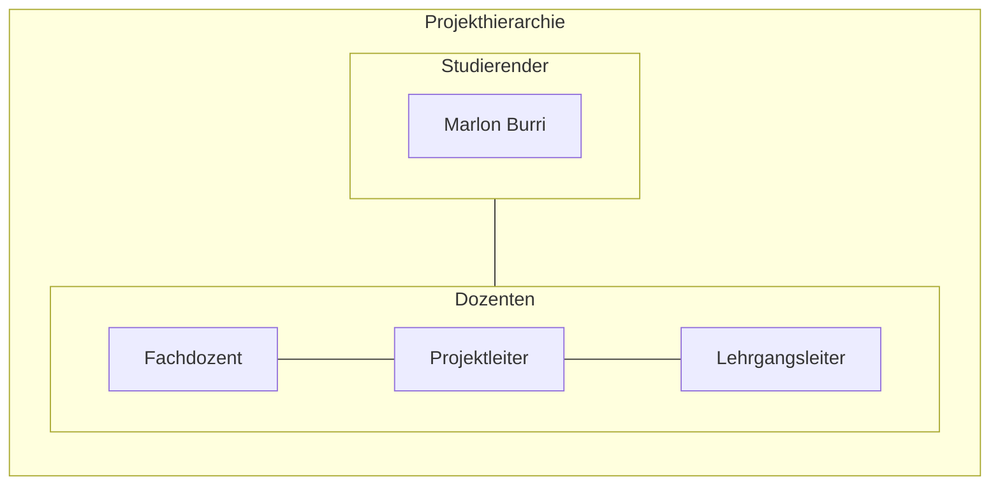

# Cloud Control Panel für AWS – Ressourcen effizient verwalten


*Das Image wurde mit Adobe Firefly erstellt.*

# Inhaltsverzeichnis

[toc]

&nbsp;

## 1 Einleitung

In diesem Projekt wird ein Bash-basiertes Control Panel für AWS entwickelt, das eine einfache und effiziente Verwaltung sowie Administration von Cloud-Ressourcen ermöglicht. Diese Arbeit basiert auf dem erarbeiteten Fachwissen aus dem ersten Semester des Lehrgangs zum dipl. Informatiker HF mit Vertiefung in Cloud Native. Diese Arbeit wurde von Marlon Burri geschrieben und ist eine Einzelarbeit.


## 1.1 Behandelte Module

- AWS-Cloud
- Infrastructure as Code
- Projektmanagement

# 2 Projektorganisation



## 2.1 Problemstellung

Mit meinem AWS-Control Panel lassen sich Ressourcen wie EC2-Instanzen, VPCs, Security Groups und mehr vollständig automatisiert per Skript erstellen und verwalten. Als wir im AWS-Cloud Modul vermehrt EC2-Instanzen sowie die dazugehörigen VPCs und Subnetze manuell erstellen musste, wurde mir schnell klar, dass dieser Prozess automatisiert werden muss. So entstand die Idee zum Control Panel. Der entscheidende Vorteil dabei ist, dass die Nutzung der AWS-Weboberfläche nahezu überflüssig wird. In Kombination mit Cloud-init lassen sich einsatzbereite Systeme automatisch bereitstellen und konfigurieren.


## 2.2 Aufgabenstellung

Basierend auf der Problembeschreibung ist das Ziel dieses Projekts die Entwicklung eines Control Panels zur Verwaltung und Bereitstellung von AWS-Ressourcen. 
Das System soll es ermöglichen, EC2-Instanzen, VPCs, Security Groups und weitere Cloud-Ressourcen vollständig per Skript zu erstellen und zu verwalten, wodurch die Nutzung der AWS-Weboberfläche weitgehend überflüssig gemacht wird. 
Diese Automatisierung soll effizient, fehlerfrei und schnell erfolgen. Für die Umsetzung wird AWS-CLI, Bash und Cloud-init verwendet. 
Der gesamte Prozess der Ressourcenbereitstellung und Verwaltung wird durch Skripte automatisiert welche sicherstellen, dass alle notwendigen Aufgaben effizient und ohne manuelle Eingriffe durchgeführt werden.

## 2.3 Ziele

* __Effizienzsteigerung und Automatisierung:__
Entwicklung eines Control Panel für die Verwaltung von AWS-Ressourcen mithilfe von Infrastructure-as-Code (IaC). 
Dabei sollen EC2-Instanzen, Netzwerke (VPCs, Subnets, Gateways), Security Groups und weitere AWS-Ressourcen durch Code automatisch erstellt, konfiguriert und verwaltet werden. 
Ziel ist es, manuelle Arbeitsschritte vollständig zu eliminieren und die Bereitstellung zu automatisieren.

* __Unabhängigkeit von der Weboberfläche:__
Vollständige Steuerung und Verwaltung von AWS-Ressourcen über die Shell mit Skripte welche mittels Bash auf die AWS CLI zugreiffen. 
Die Notwendigkeit, die AWS Management Console zu nutzen, soll entfallen, um die Verwaltung und Bereitstellung der Ressourcen effizienter und einfacher zu gestalten.

* __Standardisierung und Wiederverwendbarkeit:__
Aufbau einer strukturierten IaC-Codelogik mit wiederverwendbaren Templates und Parametern für verschiedene AWS-Komponenten. 
Dadurch können identische Setups mehrfach verwendet und standardisiert werden. 
Die Lösung soll versioniert über GitLab verwaltet werden, um Änderungen nachvollziehbar zu dokumentieren.


## 2.4 Terminplan
Zur Planung des Projektablaufs wird in Jira ein Gantt-Chart verwendet. 
Dieses dient dazu, eine Übersicht und zeitliche Strukturierung der User Stories zu erhalten. 
Änderungen können flexibel vorgenommen werden, was eine sofortige Anpassung des Plans ermöglicht. 
Das Tool wird eingesetzt, da es im agilen Projektmanagement üblich ist, dass es zu Veränderungen kommt. 
Die Jira-Timeline visualisiert diese Änderungen unmittelbar und ermöglicht so einen optimalen Überblick über den Projektverlauf.

**Der Zeitplan für die Projektsprints sieht wie folgt aus:**
| Sprint           | Titel                                 | Zeitraum                     | Ziel                                                                      |
|------------------|---------------------------------------|------------------------------|---------------------------------------------------------------------------|
| Sprint 1         | Grundlagen und Initialisierung        | 05.05.25 – 19.05.25          | Projektstruktur, Planung, AWS-Zugriffe einrichten, erstes Basis Script.   |
| Sprint 2         | Netzwerkautomatisierung               | 19.05.25 – 02.06.25          | Automatisierte Erstellung der Infrastruktur (VPCs, Subnets, Routing etc.) |
| Sprint 3         | Server Deployment und Automatisierung | 02.06.25 – 16.06.25          | EC2-Instanzen automatisiert erstellen/löschen und konfigurieren.          |
| Sprint 4         | Optimierung und Bedienbarkeit         | 16.06.25 – 30.06.25          | Code verbessern, Logging und Fehlerbehandlung einbauen.                   |
| Sprint 5         | Finalisierung und Nachbearbeitung     | 30.06.25 – 09.07.25          | Finales Testing und Dokumentation abschliessen.                            |

&nbsp;

## 2.5 Sachmittel

* AI-Tools (Chatgpt, Gemini, Copilot etc.)
* AWS-Academy
* AWS-CLI
* Bash
* Cloud-init
* Git
* Gitlab
* Jira
* Markdown
* Mermaid Markdown
* VS-Code

## 2.6 Vorgaben, Methoden und Werkzeuge

__Projektmethodik:__  

Für die Umsetzung des Projekts wird SCRUM als agile Projektmanagementmethode verwendet. 
Die Entwicklung erfolgt iterativ wodurch regelmässige Zwischenergebnisse abgeliefert und überprüft werden können. 
Bei Bedarf kann am Ende jeder Iteration das weitere Vorgehen angepasst werden. 

__Versionierungskonzept:__  

Gitlab wird zur Dokumentation und Nachverfolgung von Änderungen verwendet. 
Die Projektdateien werden in diesem Gitlab-Repository verwaltet. 
Die komplette Dokumentation des Projekts wird fortlaufend in einer Markdown Datei innerhalb des Repositories erstellt und mit den Commit Messages ergänzt. 

__Arbeitsumgebung:__  

Die Umsetzung der Arbeit erfolgt lokal auf meinem Laptop. Der Bash-Code wird dort entwickelt und anschliessend in mein GitLab-Projekt gepusht.
Über die AWS-CLI werden die benötigten Ressourcen in der AWS-Cloud erstellt, verwaltet und aufgerufen.
Als Code-Editor kommt Visual Studio Code zum Einsatz. Zur Veranschaulichung habe ich mit draw.io eine schematische Darstellung meiner Arbeitsumgebung erstellt.


*Visualisierung meiner Arbeitsumgebung.*
&nbsp;

__Test und Validierung:__  

Die Validierung des Codes findet Vortlaufend während der Entwicklung statt. Am Ende des Projekts werden zusätzlich Testfälle definiert um die Funktionsfähigkeit Final zu Messen. 

__Nicht Teil des Projektes:__  

Das Bereitstellen von weiteren Ressourcen, abgesehen von EC2-Instanzen, VPCs, Security Groups usw. ist nicht vorgesehen. Im Rahmen des Projekts werden Ressourcen ausschliesslich per Skript erstellt und gelöscht. Vorgänge wie das Umbenennen, Duplizieren oder Erweitern von Ressourcen erfolgt nicht automatisiert und ist auch nicht Bestandteil des Projekt.

__Risikoanalyse:__  

Im Rahmen dieses Projekts wurde eine Risikoanalyse durchgeführt und in der folgenden Matrix visualisiert. Dabei wurden potenzielle Risiken identifiziert und dokumentiert. 
Zu jedem Risiko wurde eine passende Massnahme definiert, die entweder im Falle des Eintritts des Risikos ergriffen oder präventiv im Vorhinein umgesetzt wird.  

Das Risikolevel wird durch die Bewertung der Eintrittswahrscheinlichkeit und der Auswirkung eines Risikos auf einer Skala von 1 bis 5 definiert und anschliessend zusammengerechnet. 
Die Eintrittswahrscheinlichkeit gibt an, wie wahrscheinlich es ist, dass ein bestimmtes Risiko tatsächlich eintritt. Sie wird auf einer Skala von 1 (niedrig) bis 5 (sehr hoch) bewertet.
Die Auswirkung beschreibt, wie gravierend die Folgen sind, wenn das Risiko tatsächlich eintritt. Sie wird ebenfalls auf einer Skala von 1 (niedrig) bis 5 (sehr hoch) bewertet. *(Dieser Text wurde mithilfe von ChatGPT geschrieben, 2025).* 
&nbsp;

Das Risiko-Level  wird in folgende Gruppen Eingestuft:
* 🔴 __Sehr hoch__ (Risiko-Level 15–25)
* 🟠 __Hoch__ (Risiko-Level 10–14)
* 🟡 __Mittel__ (Risiko-Level 5–9)
* 🟢 __Niedrig__ (1–4)  


*Screenshot von meiner Risiko Matrix aus data/RisikoMatrix.xlsx.*  

&nbsp;
&nbsp;

| Risiko-ID | Beschreibung                                                                    | Wahrscheinlichkeit | Auswirkung   | Risiko-Level | Farbe            | Massnahmen                                                           |
|-----------|---------------------------------------------------------------------------------|--------------------|--------------|--------------|------------------|----------------------------------------------------------------------|
| R1        | Skript löscht versehentlich Ressourcen ohne Rückfrage                           | 2 (niedrig)        | 2 (niedrig)  | 4            | 🟢Niedrig       | --confirm-Abfrage einbauen, dry-run verwenden, Logging aktivieren    |
| R2        | IAM-Rollen sind unzureichend konfiguriert                                       | 2 (niedrig)        | 3 (hoch)     | 6            | 🟡Mittel        | IAM-Rollen prüfen und anpassen, Least-Privilege-Prinzip umsetzen     |
| R3        | Skriptfehler durch fehlende Validierung oder Error Handling                     | 3 (mittel)         | 3 (mittel)   | 9            | 🟡Mittel        | set -e, trap, und Code regelmässig Validieren                        |                  |
| R4        | Unkontrollierte Ressourcenerstellung                                            | 3 (mittel)         | 4 (hoch)     | 12           | 🟠Hoch          | Ressourcen mit Tags versehen, regelmässige Bereinigung               |
| R5        | Falsch konfigurierter Code mit sensiblen Daten oder fehlerhaften Berechtigungen | 3 (mittel)         | 5 (sehr hoch)| 15           | 🔴Sehr hoch     | Zugangsdaten nicht als Klartext speichern, SSH-Keys für EC2 nutzen   |

&nbsp;


# 3 Projektplan

Für die Semesterarbeit wurde kein klassischer Gantt-Projektplan erstellt. Die Durchführung erfolgt vollständig nach SCRUM wesshalb es im Verlauf vom Projekt zu Änderungen am Projektplan kommen könnte. Die Aufgaben wurden in User Stories aufgeteilt und in fünf Sprints gegliedert, wobei für jeden Sprint ein klares Ziel festgelegt wurde. Um dennoch eine visuelle Planung darzustellen, wurde die Timeline vom Projekt in Jira genutzt.

Diese kann über folgenden Link aufgerufen werden: [Jira Timeline](https://marlon-burri.atlassian.net/jira/software/projects/SCRUM/boards/1/timeline)

__Platzhalter Screenshot Jira Timeline__

Die Timeline bietet einen strukturierten Überblick über alle geplanten Sprints. Änderungen an Tasks oder User Stories werden in Echtzeit sichtbar, was die Visualisierung der Projektumsetzung erleichtert.  

In Scrum werden Anforderungen hierarchisch gegliedert, um komplexe Aufgaben übersichtlich zu strukturieren. 
Epics bilden dabei die oberste Ebene. Sie beschreiben grosse, übergeordnete Anforderungen, die mehrere Sprints umfassen und in kleinere User Stories unterteilt werden. 
User Stories stellen konkrete Anforderungen aus Sicht des Nutzers dar und sind so formuliert, dass sie innerhalb eines Sprints umgesetzt werden können. 
Zur weiteren Aufteilung und besseren Planung können User Stories in Subtasks untergliedert werden. 
Das sind kleinere technische oder organisatorische Aufgaben, die für die Umsetzung der jeweiligen Story notwendig sind. *(Dieser Text wurde mithilfe von ChatGPT geschrieben, 2025).*  

```
Projekt
└── Epic
    └── User Story
        └── Subtask
```

&nbsp;

## 3.1 Bestandteile User Story
Eine User Story ist eine zentrale Einheit im agilen Arbeiten. Sie beschreibt kein einzelnes Feature, sondern ein spezifisches, kleines Endziel aus Sicht des Anwenders. Dabei handelt es sich um eine klare und leicht verständliche Beschreibung einer Aufgabe, die einem bestimmten Muster folgt. User Storys werden meist in einem einfachen Satz formuliert, der den Zweck deutlich macht. Die typische Struktur lautet:

> „Als [Rolle] möchte ich [Ziel], damit [Nutzen].“  

Dieses Muster wurde konsequent für alle User Storys in diesem Projekt verwendet. Im Screenshot ist ein Beispiel einer User Story aus meinem Projekt dargestellt.

&nbsp;

  
*Screenshot einer User Story*  
&nbsp;

Weitere wichtige Bestandteile einer User Story sind die Akzeptanzkriterien, die festlegen, wann eine Story als erfüllt gilt. Ebenso sollten Abhängigkeiten zu anderen Teams oder Tasks klar beschrieben werden. Ausserdem ist das Einhalten der Definition of Done (DoD) entscheidend, um sicherzustellen, dass alle Qualitätsanforderungen erfüllt sind. Bevor eine User Story in einen Sprint aufgenommen wird, erfolgt ausserdem eine Aufwandsschätzung in Form von Story Points, um den Umfang besser planen zu können.

&nbsp;

## 3.2 Definition of Ready (DoR)

Die Definition of Ready besteht aus individuell festgelegten Kriterien, die definieren, welche Voraussetzungen eine User Story im Product Backlog erfüllen muss, bevor sie in einen Sprint aufgenommen werden kann. 
Sie stellt sicher, dass das Team ein gemeinsames Verständnis der Aufgabe hat und diese realistisch umsetzbar ist.

* __Inhaltliche Anforderungen:__ Die User Story enthält eine vollständige Beschreibung mit allen relevanten Informationen, und das Ziel der Story ist klar definiert. Zudem sind alle notwendigen Akzeptanzkriterien formuliert, und die Story wurde vom Product Owner gegengelesen.

* __Technische Anforderungen:__ Alle technischen Abhängigkeiten wurden identifiziert. Externe Abhängigkeiten sind, falls erforderlich dokumentiert. Zudem ist klar definiert, welche Ressourcen benötigt werden (z.B. Datenbanken, Server usw.).

* __Planbarkeit:__ Die Story ist so zugeschnitten, dass sie innerhalb eines Sprints umgesetzt werden kann. Falls erforderlich, wurde sie in Tasks oder Subtasks aufgeteilt. Alle betroffenen Teams und Stakeholder wurden informiert, und es bestehen keine offenen Unklarheiten oder Blocker, die die Umsetzung behindern.

Die Definition of Ready gilt einheitlich für alle User Stories im Projekt und wird nicht individuell in die Beschreibung einzelner Stories eingefügt.

&nbsp;

## 3.3 Definition of Done (DoD)

Die Definition of Done setzt sich aus individuell festgelegten Kriterien zusammen, die definieren, wann eine User Story als vollständig abgeschlossen gilt. Sie schafft ein einheitliches Verständnis von Qualität innerhalb des Teams.

* __Umsetzung der Anforderungen:__ Alle Anforderungen und Akzeptanzkriterien der User Story sind vollständig umgesetzt und funktionieren gemäss den Vorgaben.

* __Testabdeckung:__ Die User Story ist vollständig und erfolgreich getestet. Alle Akzeptanzkriterien wurden erfüllt.

* __Dokumentation:__ Alle relevanten Änderungen und Konfigurationen sind dokumentiert. Die Dokumentation ist aktuell und für das Team zugänglich.

* __Betriebs- und Supportprozess:__ Falls erforderlich, wurde ein Prozess für den Betrieb und Support eingerichtet, um eine reibungslose Übergabe und Nachverfolgbarkeit sicherzustellen.

In JIra wurde eine Automation Rule erstellt, welche die Kriterien der Definition of Done (DoD) automatisch in das Beschreibungsfeld eingefügt, sobald ein neues Backlog Item erstellt wird.

&nbsp;

## 3.4 Projekt Sprints

### 3.4.1 Sprint 1

Ziel des ersten Sprints ist es, die Grundlagen und Voraussetzungen für das Projekt zu schaffen. 
Dazu gehören unter anderem die Erstellung einer Risikoanalyse, die Planung des weiteren Vorgehens sowie die Dokumentation der Organisationsstruktur. 
Am Ende des ersten Sprints sollen alle notwendigen Vorarbeiten geleistet sein, sodass mit der eigentlichen Umsetzung gestartet werden kann.

__Sprint Planning:__  

Zu Beginn musste der Aufwand von den am höchsten priorisierten User Stories anhand von Storypoints geschätzt werden. 
Da im Rahmen dieser Arbeit nur eine einzelne Person das SCRUM-Team bildet, ist ein separates Backlog Refinement nicht sinnvoll.
Die Schätzung der Storypoints erfolgt daher direkt im Sprint Planning. 

Im Sprint Planning wurde zunächst ermittelt, wie viel Kapazität anhand von Storypoints zur Verfügung steht. 
Für den ersten Sprint wurde ein Ziel von fünf Storypoints gesetzt. Ein Storypoint entspricht dabei einem Arbeitstag mit acht Stunden Aufwand. 
Entsprechend werden Aufgaben mit einem Gesamtaufwand von fünf Storypoints eingeplant. 

Im Anschluss wurde in Jira der erste Sprint erstellt, welcher vom 5. Mai bis zum 19. Mai 2025 läuft. 
Abschliessend wurden falls erforderlich, Subtasks zu den Stories angelegt, um die Aufgaben besser strukturieren und aufteilen zu können.  


*Screenshot von meinem Sprint 1 Backlog in Jira.*

__Sprint Review:__ 

In der Sprint Review wurden die Ergebnisse des ersten Sprints vorgestellt und gemeinsam mit dem Projektmanagement-Lehrer Projektleiter besprochen. Dabei wurde gezielt Feedback eingeholt, um die weitere Projektarbeit zu verbessern. 

Ein wesentlicher Diskussionspunkt war die Deklaration von Inhalten, die mithilfe von künstlicher Intelligenz (KI) erstellt wurden. Es wurde festgelegt, dass solche Inhalte eindeutig deklariert und die verwendeten Prompts im Quellenverzeichnis aufgeführt werden sollen.
Zudem wurde darüber diskutiert, ob zusätzlich zur Jira-Timeline ein Gantt-Diagramm erstellt werden soll, um den Projektplan visuell darzustellen. Nach gemeinsamer Absprache wurde entschieden, dass die Visualisierung über die Jira-Timeline ausreichend ist und somit kein separates Gantt-Diagramm erstellt wird. 

Insgesamt konnte der erste Sprint erfolgreich abgeschlossen werden und die definierten Sprintziele wurden erreicht. Darüber hinaus wurde die Sprint Review für den zweiten Sprint bereits geplant.


*Screenshot von meiner Timeline nach dem ersten Sprint.*

### 3.4.2 Sprint 2

__Sprint Planning:__

Seit dem letzten Mal, als die verbleibenden User Stories im Backlog betrachtet wurden, wurde das Projekt grob geplant und die Stories erstellt. Jedoch waren sie zu diesem Zeitpunkt noch nicht im Detail beschrieben.

Daher bestand der erste Schritt darin, für alle User Stories aussagekräftige Beschreibungen zu verfassen und passende Akzeptanzkriterien zu definieren, um eine klare Grundlage für die Umsetzung zu schaffen. Anschliessend wurde anhand der Story Points ermittelt, wie viel Kapazität zur Verfügung steht. Für den zweiten Sprint wurden User Stories im Gesamtumfang von fünf Story Points eingeplant.

Zum Abschluss wurde in Jira der zweite Sprint erstellt, welcher vom 19. Mai bis zum 2. Juni 2025 läuft. Zusätzlich wurden für einige User Stories Sub-Tasks angelegt, um die Aufgaben innerhalb der Stories besser aufteilen und effizienter bearbeiten zu können.


*Screenshot von meinem Sprint 2 Backlog in Jira.*

__Sprint Review:__

### 3.4.3 Sprint 3

__Sprint Planning:__

__Sprint Review:__

### 3.4.4 Sprint 4

__Sprint Planning:__

__Sprint Review:__

### 3.4.5 Sprint 5

__Sprint Planning:__


# 4 Lösungsdesign

## 4.1 Main Script

  

*Flowchart – Main-Script | Erstellt von: Marlon Burri | Stand: 16.05.2025 | Version: 1.0 | Tool: draw.io*

## 4.2 EC2 Script

  

*Flowchart – EC2-Script | Erstellt von: Marlon Burri | Stand: 16.05.2025 | Version: 1.0 | Tool: draw.io*

## 4.3 VPC Script

  

*Flowchart – VPC-Script | Erstellt von: Marlon Burri | Stand: 16.05.2025 | Version: 1.0 | Tool: draw.io*

## 4.4 Subnet Script

  

*Flowchart – Subnet-Script | Erstellt von: Marlon Burri | Stand: 16.05.2025 | Version: 1.0 | Tool: draw.io*

# 5 Umsetzung

__Main Script:__

Mit der effektiven Entwicklung des Codes wurde im zweiten Sprint begonnen. Die erste User Story dieses Sprints ([SCRUM-23](https://marlon-burri.atlassian.net/jira/software/projects/SCRUM/boards/1?selectedIssue=SCRUM-23&sprintStarted=true)) umfasste die Entwicklung des Main-Script, das als Hauptmenü dient, sowie der zugehörigen Submenüs (EC2-Menu, VPC-Menu usw.). 
Das Main-Script wurde schrittweise aufgebaut, um ein benutzerfreundliches Control Panel zu bereitzustellen. Die Idee, den Titel mithilfe von ASCII-Zeichen darzustellen, entstand spontan und verleiht dem Projekt ein gewisses Wiedererkennungsmerkmal. 
Für das Design kam die Star-Wars-Schriftart aus dem ASCII-Generator von [Patorjk](https://patorjk.com/software/taag/#p=display&f=Star%20Wars&t=Type%20Something%20) zum Einsatz.

Zu Beginn wurden die Variablen und Farbdefinitionen in separate Scripts ausgelagert, um eine zentrale und wiederverwendbare Struktur für alle weiteren Scripts zu schaffen. 
Anschliessend wurde ein Hauptmenü entwickelt, das dem Benutzer verschiedene Auswahlmöglichkeiten wie EC2, VPC, Subnetze und Security Groups bietet. 
Jede dieser Kategorien ist über ein eigenes Script organisiert. Das Vorgehen basiert auf einer klaren Trennung der Funktionalitäten (Modularisierung) und kann beliebig erweitert werden, um eine noch Benutzerfreundliche Bedienung zu gewährleisten

```bash
#!/bin/bash

# variables
source "$(dirname "$0")/colors.bash"
source "$(dirname "$0")/variables.bash"

# header 
print_header() {
    clear
    echo -e "${BOLD_YELLOW}"
    echo "      ___   ____    __    ____   _______.     ______   ______   .__   __. .___________..______        ______    __         .______      ___      .__   __.  _______  __      "
    echo "     /   \  \   \  /  \  /   /  /       |    /      | /  __  \  |  \ |  | |           ||   _  \      /  __  \  |  |        |   _  \    /   \     |  \ |  | |   ____||  |     "
    echo "    /  ^  \  \   \/    \/   /  |   (----\`   |  ,----'|  |  |  | |   \|  | \`---|  |----\`|  |_)  |    |  |  |  | |  |        |  |_)  |  /  ^  \    |   \|  | |  |__   |  |     "
    echo "   /  /_\  \  \            /    \   \       |  |     |  |  |  | |  . \`  |     |  |     |      /     |  |  |  | |  |        |   ___/  /  /_\  \   |  . \`  | |   __|  |  |     "
    echo "  /  _____  \  \    /\    / .----)   |      |  \`----.|  \`--'  | |  |\   |     |  |     |  |\  \----.|  \`--'  | |  \`----.   |  |     /  _____  \  |  |\   | |  |____ |  \`----."
    echo " /__/     \__\  \__/  \__/  |_______/        \______| \______/  |__| \__|     |__|     | _| \`._____| \______/  |_______|   | _|    /__/     \__\ |__| \__| |_______||_______|"
    echo -e "${NC}"
    
    echo -e "${WHITE}"
    echo "╔══════════════════════════════════════════════════════════════╗"
    echo "║                       AWS-ControlPanel v1.0                  ║"
    echo "╠══════════════════════════════════════════════════════════════╣"
    echo "║ Author       : Marlon Burri (marlob03)                       ║"
    echo "║ Purpose      : Manage and automate AWS resources             ║"
    echo "║ Features     : EC2, VPC, Subnets, Security Groups            ║"
    echo "║ Environment  : Bash CLI interface with modular structure     ║"
    echo "║ Session Info : $USER@$HOSTNAME | $DATE             ║"
    echo "╚══════════════════════════════════════════════════════════════╝"
    echo -e "${NC}"
}


# menu 
show_menu() {
    echo -e "${BOLD_BLUE}"
    echo "1. EC2-Menu"
    echo "2. VPC-Menu"
    echo "3. Subnet-Menu"
    echo "4. SecurityGroup-Menu"
    echo "5. Exit"
    echo -e "${NC}"
}

# input
read_input() {
    read -rp "Please select an option: " choice
    case "$choice" in
        1)
            echo -e "${BOLD_YELLOW}You selected EC2-Menu. Loading EC2 options...${NC}"
            bash "$(dirname "$0")/ec2_menu.bash"
            ;;
        2)
            echo -e "${BOLD_YELLOW}You selected VPC-Menu. Loading VPC options...${NC}"
            bash "$(dirname "$0")/vpc_menu.bash"
            ;;
        3)
            echo -e "${BOLD_YELLOW}You selected Subnet-Menu. Loading Subnet options...${NC}"
            bash "$(dirname "$0")/subnet_menu.bash"
            ;;
        4)
            echo -e "${BOLD_YELLOW}You selected SecurityGroup-Menu. Loading Security Group options...${NC}"
            bash "$(dirname "$0")/securitygroup_menu.bash"
            ;;
        5)
            echo -e "${BOLD_YELLOW}Exiting program. Goodbye!${NC}"
            source "$(dirname "$0")/ascii_logo.bash"
            print_ascii_logo
            exit 0
            ;;
        *)
            echo -e "${RED}Invalid option. Please try again.${NC}"
            ;;
    esac
}


# pause
pause() {
    read -rp "Press [Enter] key to continue..."
}

# main loop
main() {
    while true; do
        print_header
        show_menu
        read_input
        pause
    done
}


# Only executes if it runs directly
if [[ "${BASH_SOURCE[0]}" == "${0}" ]]; then
    main
fi
```

> __Hinweis__: Dieses Script repräsentiert den aktuellen Arbeitsstand des Main-Script. Es befindet sich in aktiver Entwicklung und stellt noch nicht die endgültige Version dar.

&nbsp;


*Aktuelles Abbild – Main-Script | Erstellt von: Marlon Burri | Stand: 25.05.2025 | Version: 1.0*

&nbsp;

__EC2 Script:__  

Das EC2-Script übernimmt die vollständige Bereitstellung, Konfiguration sowie das Löschen von EC2-Instanzen. Es beinhaltet die gleichen Variablen wie das Main-Script und ist ähnlich aufgebaut. Das Script bietet dem Benutzer ein übersichtliches Menü zur Auswahl verschiedener Operationen, darunter das Erstellen, Anzeigen und Löschen von EC2-Instanzen.

Der Header ist bewusst schlicht gehalten, ohne eine ASCII-Schriftzug jedoch wird dennoch klar anzeigt, in welchem Menü sich der Benutzer befindet.
Bei der Auswahl einer Option wird ein separater Bash-Prozess gestartet, der das jeweils referenzierte Unterskript ausführt (z. B. ```ec2_create.bash```, ```ec2_list.bash```, ```ec2_delete.bash```). Nach Abschluss des Prozesses gibt das Script eine Zusammenfassung der ausgeführten Aktion aus und kehrt nach bestätigung des Anwenders ins EC2-Menü zurück.

Zur Ausführung des Scripts wurde eine Hauptschleife definiert. Die Funktion ruft in einer Endlosschleife wiederholt folgende vier Funktionen auf:

```print_header``` – zeigt den Menü-Kopf an.

```show_menu``` – listet die verfügbaren Optionen auf.

```handle_input``` – verarbeitet die Benutzereingabe.

```pause``` – hält das Skript kurz an, bis der Benutzer eine Taste drückt.

Der ```if```-Block am Ende sorgt dafür, dass die Funktion nur ausgeführt wird, wenn das Script direkt aufgerufen wird, nicht wenn es von einem anderen Script importiert oder gesourced wird. Das macht das Skript modular und wiederverwendbar.

```bash
#!/bin/bash

# variables
source "$(dirname "$0")/init_env.bash"

# menu
show_menu() {
    echo -e "${BOLD_BLUE}"
    echo "1. Create EC2 Instance"
    echo "2. List EC2 Instances"
    echo "3. Delete EC2 Instance"
    echo "4. Create new full EC2 Environment"
    echo "5. Back to Main Menu"
    echo "6. Exit Program"
    echo -e "${NC}"
}

# pause
pause() {
    read -rp "Press [Enter] to continue..."
}

# handle input
handle_input() {
    read -rp "Select an option: " choice
    case "$choice" in
        1)
            echo -e "${BOLD_YELLOW}Loading EC2 creation process...${NC}"
            bash "$(dirname "$0")/ec2_create.bash"
            ;;
        2)
            echo "Listing EC2 instances..."
            bash "$(dirname "$0")/ec2_list.bash"
            ;;
        3)
            echo -e "${BOLD_YELLOW}Loading EC2 deletion process...${NC}"
            bash "$(dirname "$0")/ec2_delete.bash"
            ;;
        4)
            echo "Creating new full EC2 environment..."
            bash "$(dirname "$0")/ec2_fullenviroment.bash"
            ;;
        5)
            echo "Returning to Main Menu..."
            source "$(dirname "$0")/main.bash"
            exit 0
            ;;
        6)
            echo -e "${BOLD_YELLOW}Exiting program. Goodbye!${NC}"
            source $LIBDIR/ascii_logo.bash
            print_ascii_logo
            kill $PPID
            exit 0
            ;;
        *)
            echo -e "${RED}Invalid option.${NC}"
            ;;
    esac
}


# main loop
main_ec2_menu() {
    while true; do
        print_header
        show_menu
        handle_input
        pause
    done
}

# Only executes if it runs directly
if [[ "${BASH_SOURCE[0]}" == "${0}" ]]; then
    main_ec2_menu
fi
```

> __Hinweis__: Dieses Script repräsentiert den aktuellen Arbeitsstand des EC2-Script. Es befindet sich in aktiver Entwicklung und stellt noch nicht die endgültige Version dar.

&nbsp;

  
*Aktuelles Abbild – EC2-Script | Erstellt von: Marlon Burri | Stand: 30.05.2025 | Version: 1.0*

&nbsp;

Alle weiteren Submenüs wie ```vpc_menu.bash```, ```subnet_menu.bash``` und ```securitygroup_menu.bash``` wurden nach dem gleichen Schema wie das ```EC2_menu.bash``` entwickelt. Sie sind modular aufgebaut und können bei Bedarf auch unabhängig vom Main-Script ausgeführt werden.

Hinter jedem dieser Menüscripte stehen weitere Einzelscripte, die konkrete Aufgaben übernehmen wie z.B das Erstellen oder Löschen einer EC2-Instanz. Wählt der Benutzer eine entsprechende Option im Menü, wird er zur Eingabe relevanter Parameter aufgefordert, wie beispielsweise dem Namen der Instanz. Alternativ lassen sich diese Parameter auch direkt über die Kommandozeile beim Einzelaufruf der jeweiligen Scripte übergeben, was eine flexible und automatisierte Nutzung ermöglicht.

&nbsp;

__Server Konfiguration:__   

Beim Erstellprozess einer EC2-Instanz besteht die Möglichkeit, das System mithilfe von cloud-init automatisch zu konfigurieren. Der darin enthaltene Konfigurationscode wird jeweils beim Start des Systems ausgeführt und kann verschiedene Einrichtungsschritte automatisieren. Die Konfigurationsdateien enden mit der Dateiendung ```.yaml``` und beginnen mit der Direktive ```#cloud-config```. Das cloud-init-Konfigurationstemplat beinhalten unter anderem die Erstellung meines persönlichen Benutzers (marlob), welcher der sudo-Gruppe zugewiesen ist. Dieser Benutzer kann sich neben dem hinterlegten SSH-Key auch über ein im Template hinterlegtes, als Hash gespeichertes Passwort authentifizieren.

Zusätzlich werden automatisch die SSH Keys von zwei Lehrpersonen und mir im Standard-User (ubuntu) auf der Instanz hinterlegt. Das Einfügen dieser SSH-Keys dient ausschliesslich der Veranschaulichung, wie eine Zusammenarbeit mehrerer Benutzer auf einem System organisiert werden könnte. Für die Bewertung meiner Semesterarbeit ist es jedoch nicht erforderlich, dass die Lehrpersonen Zugriff auf die Systeme haben.

Darüber hinaus werden wichtige Pakete wie vim und curl automatisch installiert.
Aus sicherheitstechnischen Gründen wird am Ende des cloud-init-Templates die erneute Ausführung von cloud-init auf dem System deaktiviert, um unbeabsichtigte Änderungen bei zukünftigen Neustarts zu verhindern.

```yaml
#cloud-config

users:
  - name: marlob
    sudo: ALL=(ALL) NOPASSWD:ALL
    groups: sudo
    homedir: /home/marlob
    shell: /bin/bash
    lock_passwd: false
    passwd: <sha512-crypt-hash-of-your-password>
    ssh_authorized_keys:
      - ssh-rsa AAAAB3NzaC1yc2EAAAADAQABAAACAQDSAgeAmyw8sIph8AWkngIf3DomfsbEvzj6ErBmeUmhPjNd4H8d9FfWUKoarpQpjB1HEFL2krbWlldBO+e4t8Ckds+1RqobFeXLeoI91XXyEEWR+WY3dfRUAgBAtXDlOoWSU6uq8Shsg62EUQSKE9diHKujt07TYDyNv1hfN1rcJWzktrCPuxCVBDQdjtornhssl0dY1//uO5OwkGHiDUPSwCFmMoB5oJqBx8trqrAkX8sudKzzykv+WmFEVCzRjVe6j5Q1iiqzkMrHeSyp/RH2R1f4bXqKbeA0CoFcApa0A7Wvkd33ig5BE5NpqUjy99sRKN1zAYAI1JHZOKgy6wLaCjLnibkAbmhUKW0C2J4MeF8s2pPCqIlDCK6+bMkA6bIdtxW93cCI8C6qaNr35hwT9wH8XQ3JHW2GEEPNZZ5vfwMPs+7kjxl8BQRSGPcpbSGylZ7xnUmiCpq+UKLdyA/Am70xyWJ70hVwJPndbwAZ3FyzPnAYS4J8dnF+1Xmt1dFkv9dYtJbfGuOAZ7Q9TVWax01OIvb8yb/FEObjlDbTx4C491iTLizsFYfE4vRcT0HEE/qUQhdr8/7Iq17cVadAZaLScvXVhVpKJaF0GcEN+6VnUR2Fa4X2EZZoZRHHKqr3G/qa3avP4dNW6rq3wyfhZKTQBcRHGzgUAQ0Evo9ItQ== marlo@PC-BURRI
  

  - name: ubuntu
    sudo: ALL=(ALL) NOPASSWD:ALL
    groups: sudo
    homedir: /home/ubuntu
    shell: /bin/bash
    passwd: np
    ssh_authorized_keys:
      - ssh-rsa AAAAB3NzaC1yc2EAAAADAQABAAACAQDSAgeAmyw8sIph8AWkngIf3DomfsbEvzj6ErBmeUmhPjNd4H8d9FfWUKoarpQpjB1HEFL2krbWlldBO+e4t8Ckds+1RqobFeXLeoI91XXyEEWR+WY3dfRUAgBAtXDlOoWSU6uq8Shsg62EUQSKE9diHKujt07TYDyNv1hfN1rcJWzktrCPuxCVBDQdjtornhssl0dY1//uO5OwkGHiDUPSwCFmMoB5oJqBx8trqrAkX8sudKzzykv+WmFEVCzRjVe6j5Q1iiqzkMrHeSyp/RH2R1f4bXqKbeA0CoFcApa0A7Wvkd33ig5BE5NpqUjy99sRKN1zAYAI1JHZOKgy6wLaCjLnibkAbmhUKW0C2J4MeF8s2pPCqIlDCK6+bMkA6bIdtxW93cCI8C6qaNr35hwT9wH8XQ3JHW2GEEPNZZ5vfwMPs+7kjxl8BQRSGPcpbSGylZ7xnUmiCpq+UKLdyA/Am70xyWJ70hVwJPndbwAZ3FyzPnAYS4J8dnF+1Xmt1dFkv9dYtJbfGuOAZ7Q9TVWax01OIvb8yb/FEObjlDbTx4C491iTLizsFYfE4vRcT0HEE/qUQhdr8/7Iq17cVadAZaLScvXVhVpKJaF0GcEN+6VnUR2Fa4X2EZZoZRHHKqr3G/qa3avP4dNW6rq3wyfhZKTQBcRHGzgUAQ0Evo9ItQ== marlo@PC-BURRI
      - ssh-rsa AAAA...replace-with-a-team-member-key teammate@example.com
      - ssh-rsa AAAA...replace-with-a-team-member-key teammate@example.com

ssh_pwauth: true
disable_root: false
package_update: true 
packages:
  - curl
  - wget
  - vim
  - nano 
  - htop
  - net-tools

runcmd:
  - sudo touch /etc/cloud/cloud-init.disabled
```
*Aktuelles Abbild – Template_Ubuntu.yaml | Erstellt von: Marlon Burri | Stand: 31.05.2025 | Version: 1.0*

&nbsp;

# 6 Testverfahren

# 7 Projektabschluss

## 7.1 Technisches Fazit

## 7.2 Persönliches Fazit

## 7.3 Mögliche Weiterentwicklung

# 8 Schlusswort

## 8.1 Glossar


## 8.2 Quellenverzeichnis

* Adobe Firefly (2025, Mai 05). *Prompt: Amazon Web Service Control Panel* Adobe Firefly: https://firefly.adobe.com
* ChatGPT (2025, Mai 09). *Antwort von ChatGPT auf die Frage: Wir wird das Risiko-Level Berechnet?* ChatGPT: https://chatgpt.com
* ChatGPT (2025, Mai 12). *Antwort von ChatGPT auf die Frage: Wie ist das Backlog hierarchisch gegliedert?* ChatGPT: https://chatgpt.com
* Text to ASCII Art Generator (2025, Mai 22): https://patorjk.com/software/taag/#p=display&f=Graffiti&t=Type%20Something%20
