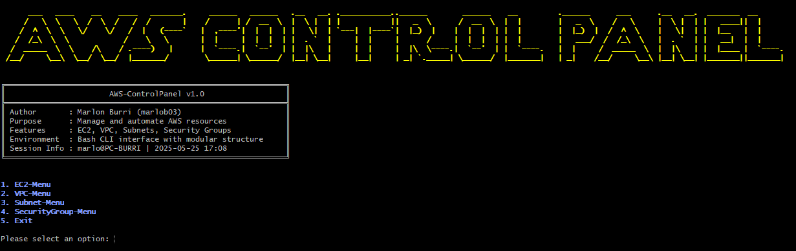
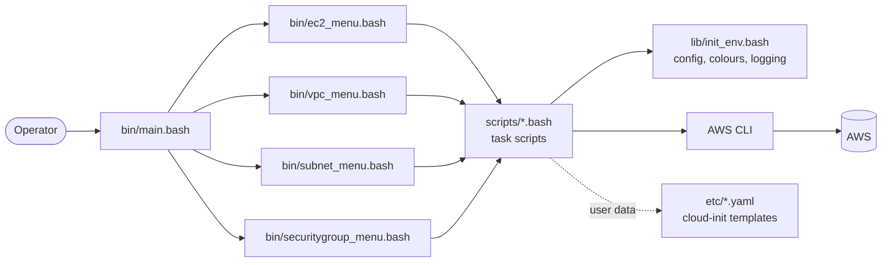
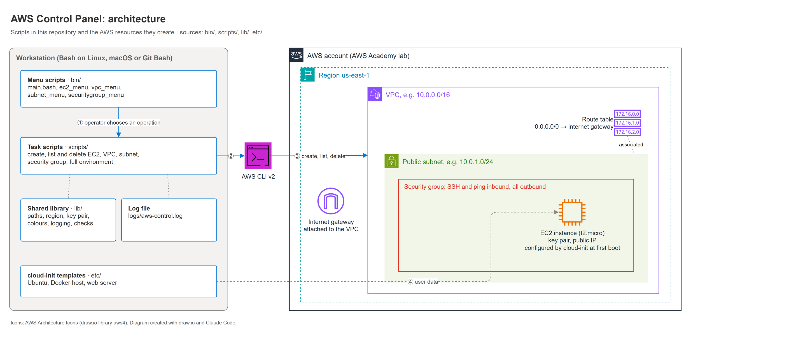

# AWS Control Panel

**A modular Bash control panel that provisions and manages AWS resources (EC2, VPC, subnets, security groups) entirely from the command line, without the AWS Management Console.**




## Why

Creating EC2 instances together with their VPCs, subnets and security groups by hand in the web console is slow and error-prone. The control panel wraps the AWS CLI in an interactive, menu-driven tool: every resource can be created, listed and deleted in a few keystrokes. New servers are configured automatically at first boot via cloud-init.

## Highlights

- **Menu-driven CLI**: a main menu with sub-menus for EC2, VPC, subnets and security groups.
- **Reusable task scripts**: every operation (`ec2_create`, `vpc_delete`, ...) is a standalone script that works from the menu *and* on its own, which makes it easy to automate or test.
- **One-shot environments**: `ec2_fullenviroment.bash` builds a VPC, public subnet, internet gateway, route table, security group and EC2 instance in one run.
- **Zero-touch server setup**: cloud-init templates create users, deploy SSH keys and install packages (Ubuntu, Docker host, web server).
- **Logging and error handling**: every action is written with a timestamp and severity to `logs/aws-control.log`; AWS credentials and CLI availability are checked before any call.
- **Relocatable**: all paths are resolved relative to the repository, so the tool runs from any working directory.

## Architecture





*Created with draw.io; icons: AWS Architecture Icons.*

Menu scripts in `bin/` form the interactive front end. Task scripts in `scripts/` do the actual work and share one initialisation file (`lib/init_env.bash`) for paths, configuration, colours and logging. Details: [docs/architecture.md](docs/architecture.md).

## Getting started

**Prerequisites:** Bash (Linux, macOS or Git Bash on Windows), [AWS CLI v2](https://docs.aws.amazon.com/cli/latest/userguide/getting-started-install.html) configured with valid credentials (e.g. `aws configure` or an AWS Academy session), and an existing EC2 key pair.

```bash
git clone https://github.com/marlonburri03/aws-controlpanel.git
cd aws-controlpanel

# adjust region, instance type and key pair name
vi lib/aws_config.bash

# start the interactive control panel
./bin/main.bash

# or run a single task directly
./scripts/ec2_list.bash
```

Before using the cloud-init templates in `etc/`, replace the placeholders for the password hash and SSH keys with your own values.

## Repository structure

```text
bin/        menu scripts (interactive front end)
scripts/    task scripts, one per operation, runnable on their own
lib/        shared initialisation: paths, AWS config, colours, logging
etc/        cloud-init templates used as EC2 user data
logs/       runtime log file (not versioned)
docs/       documentation, diagrams and screenshots
```

## Documentation

| Document | Content |
|---|---|
| [Architecture](docs/architecture.md) | Script design, control flow, cloud-init, logging |
| [Testing](docs/testing.md) | Test approach and 10 recorded test cases |
| [Project management](docs/project-management.md) | Goals, scope, risks, Scrum setup and sprints |
| [Retrospective](docs/retrospective.md) | Technical and personal conclusions, next steps |
| [Glossary](docs/glossary.md) | Terms and references |

## Project context

Built as an individual semester project (1st semester) of the Higher Diploma in Computer Science, specialisation Cloud Native, in spring 2025. Delivered in five two-week Scrum sprints; all 10 test cases passed.

## Author

Marlon Burri, [github.com/marlonburri03](https://github.com/marlonburri03)
