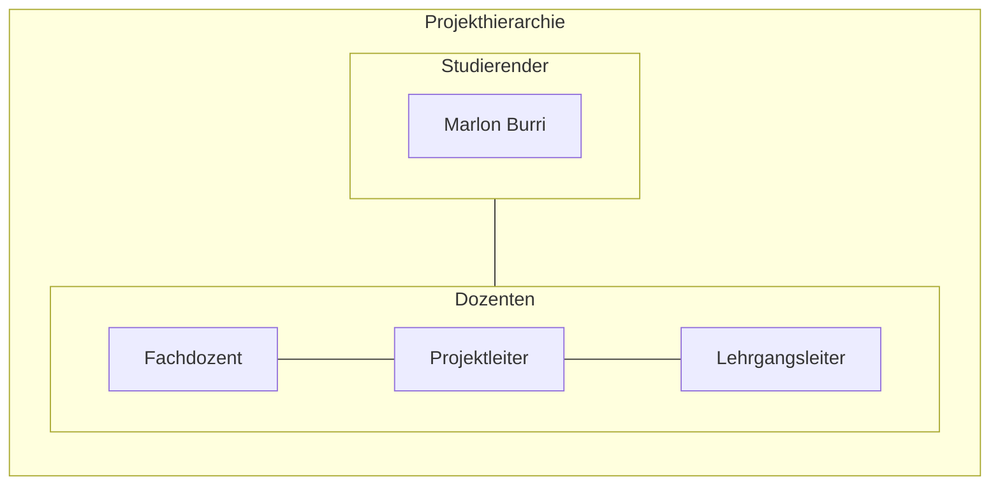

# Cloud Control Panel für AWS – Ressourcen effizient verwalten

*Das Image wurde mit Adobe Firefly erstellt.*

# Inhaltsverzeichnis

[toc]

## 1 Einleitung

In diesem Projekt wird ein Bash-basiertes Control Panel für AWS entwickelt, das eine einfache und effiziente Verwaltung sowie Administration von Cloud-Ressourcen ermöglicht.

## 1.1 Behandelte Module

- AWS-Base
- Infrastructure as Code

# 2 Projektorganisation

## 2.1 Problemstellung

## 2.2 Aufgabenstellung

## 2.3 Ziele

## 2.4 Terminplan

## 2.5 Sachmittel

## 2.6 Vorgaben, Methoden und Werkzeuge

### 2.6.1 Projektmanagementmethod

### 2.6.2 Versionierungskonzept

### 2.6.3 Arbeitsumgebung

### 2.6.4 Nicht Teil des Projektes

### 2.6.5 Risikoanalyse

## 2.7 Projekt Sprints

# 3 Projektplan

# 4 Architekturdiagramm

# 5 Lösungsdesign