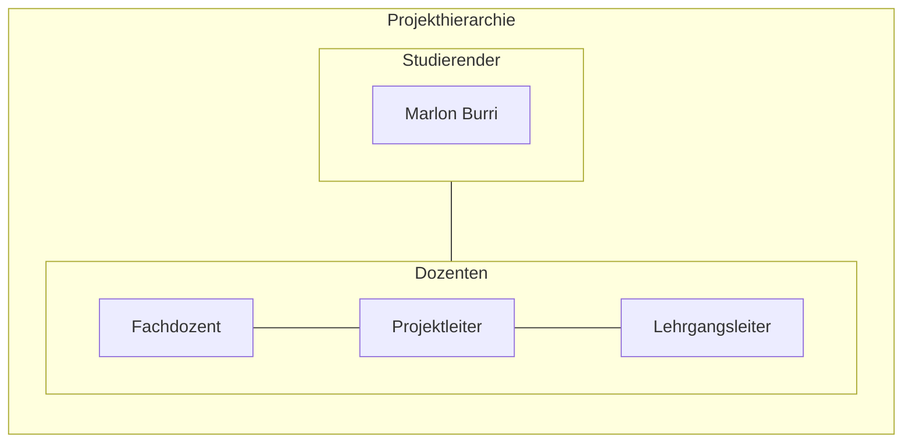

# Cloud Control Panel für AWS – Ressourcen effizient verwalten

*Das Image wurde mit Adobe Firefly erstellt.*

# Inhaltsverzeichnis

[toc]

## 1 Einleitung

In diesem Projekt wird ein Bash-basiertes Control Panel für AWS entwickelt, das eine einfache und effiziente Verwaltung sowie Administration von Cloud-Ressourcen ermöglicht. Diese Arbeit basiert auf dem erarbeiteten Fachwissen aus dem ersten Semester des Lehrgangs zum dipl. Informatiker HF mit Vertiefung in Cloud Native. Diese Arbeit wurde von Marlon Burri geschrieben und ist eine Einzelarbeit.

## 1.1 Behandelte Module

- AWS-Base
- Infrastructure as Code
- Projektmanagement

# 2 Projektorganisation

## 2.1 Problemstellung

Mit meinem AWS-Control Panel lassen sich Ressourcen wie EC2-Instanzen, VPCs, Security Groups und mehr vollständig automatisiert per Skript erstellen und verwalten. 
Der entscheidende Vorteil dabei, die Nutzung der AWS-Weboberfläche wird nahezu überflüssig. 
In Kombination mit Cloud-init lassen sich einsatzbereite Systeme automatisch bereitstellen und konfigurieren. 

## 2.2 Aufgabenstellung

Basierend auf der Problembeschreibung ist das Ziel dieses Projekts die Entwicklung eines Control Panels zur Verwaltung und Bereitstellung von AWS-Ressourcen. 
Das System soll es ermöglichen, EC2-Instanzen, VPCs, Security Groups und weitere Cloud-Ressourcen vollständig per Skript zu erstellen und zu verwalten, wodurch die Nutzung der AWS-Weboberfläche weitgehend überflüssig gemacht wird. 
Diese Automatisierung soll effizient, fehlerfrei und schnell erfolgen. Für die Umsetzung wird AWS-CLI, Bash und Cloud-init verwendet. 
Der gesamte Prozess der Ressourcenbereitstellung und Verwaltung wird durch Skripte automatisiert welche sicherstellen, dass alle notwendigen Aufgaben effizient und ohne manuelle Eingriffe durchgeführt werden.

## 2.3 Ziele

* __Effizienzsteigerung und Automatisierung:__
Entwicklung eines Control Panel für die Verwaltung von AWS-Ressourcen mithilfe von Infrastructure-as-Code (IaC). 
Dabei sollen EC2-Instanzen, Netzwerke (VPCs, Subnets, Gateways), Security Groups und weitere AWS-Ressourcen durch Code automatisch erstellt, konfiguriert und verwaltet werden. 
Ziel ist es, manuelle Arbeitsschritte vollständig zu eliminieren und die Bereitstellung zu automatisieren.

* __Unabhängigkeit von der Weboberfläche:__
Vollständige Steuerung und Verwaltung von AWS-Ressourcen über die Shell mit Skripte welche mittels Bash auf die AWS CLI zugreiffen. 
Die Notwendigkeit, die AWS Management Console zu nutzen, soll entfallen, um die Verwaltung und Bereitstellung der Ressourcen effizienter und einfacher zu gestalten.

* __Standardisierung und Wiederverwendbarkeit:__
Aufbau einer strukturierten IaC-Codelogik mit wiederverwendbaren Templates und Parametern für verschiedene AWS-Komponenten. 
Dadurch können identische Setups mehrfach verwendet und standardisiert werden. 
Die Lösung soll versioniert über GitLab verwaltet werden, um Änderungen nachvollziehbar zu dokumentieren.

## 2.4 Terminplan
Zur Planung des Projektablaufs wird in Jira ein Gantt-Chart verwendet. 
Dieses dient dazu, eine Übersicht und zeitliche Strukturierung der User Stories zu erhalten. 
Änderungen können flexibel vorgenommen werden, was eine sofortige Anpassung des Plans ermöglicht. 
Das Tool wird eingesetzt, da es im agilen Projektmanagement üblich ist, dass es zu Veränderungen kommt. 
Die Jira-Timeline visualisiert diese Änderungen unmittelbar und ermöglicht so einen optimalen Überblick über den Projektverlauf.

**Der Zeitplan für die Projektsprints sieht wie folgt aus:**
| Sprint     | Titel                                 | Zeitraum                     | Ziel                                                                      |
|------------------|---------------------------------------|------------------------------|---------------------------------------------------------------------------|
| Sprint 1         | Grundlagen und Initialisierung        | 05.05.25 – 19.05.25          | Projektstruktur, Planung, AWS-Zugriffe einrichten, erstes Basis Script.   |
| Sprint 2         | Netzwerkautomatisierung               | 19.05.25 – 02.06.25          | Automatisierte Erstellung der Infrastruktur (VPCs, Subnets, Routing etc.) |
| Sprint 3         | Server Deployment und Automatisierung | 02.06.25 – 16.06.25          | EC2-Instanzen automatisiert erstellen/löschen und konfigurieren.          |
| Sprint 4         | Optimierung und Bedienbarkeit         | 16.06.25 – 30.06.25          | Code verbessern, Logging und Fehlerbehandlung einbauen.                   |
| Sprint 5         | Finalisierung und Nachbearbeitung     | 30.06.25 – 09.07.25          | Finales Testing und Dokumentation abschließen.                            |

## 2.5 Sachmittel

* AI-Tools (Chatgpt, Gemini, Copilot etc.)
* AWS-Academy
* AWS-CLI
* Bash
* Cloud-init
* Git
* Gitlab
* Jira
* Markdown
* Mermaid Markdown
* VS-Code

## 2.6 Vorgaben, Methoden und Werkzeuge

### 2.6.1 Projektmethodik
Für die Umsetzung des Projekts wird SCRUM als agile Projektmanagementmethode verwendet. 
Die Entwicklung erfolgt iterativ wodurch regelmässige Zwischenergebnisse abgeliefert und überprüft werden können. 
Bei Bedarf können am Ende der Iteration das weitere Vorgehen angepasst werden. 

### 2.6.2 Versionierungskonzept
Gitlab wird zur Dokumentation und Nachverfolgung von Änderungen verwendet. 
Die Projektdateien werden in einem Gitlab-Repository verwaltet. 
Die komplette Dokumentation des Projekts wird fortlaufend in einer Markdown Datei innerhalb des Repositories erstellt und mit den Commit Messages ergänzt. 

### 2.6.3 Arbeitsumgebung
Im Projekt wird die AWS-CLI mit Bash verwendet. Um die EC2-Instanzen zu konfigurieren, verwende Ich Cloud-init. 
Als Code Editor wird Visual Studio Code verwendet. 

### 2.6.4 Test und Validierung
Das Testing findet während jedem Sprint statt. Am Ende des Projekts werden zusätzlich Testfälle definiert um die Funktionsfähigkeit Final zu Messen. 

### 2.6.5 Nicht Teil des Projektes

### 2.6.6 Risikoanalyse

## 2.7 Projekt Sprints

# 3 Projektplan

# 4 Architekturdiagramm

# 5 Lösungsdesign