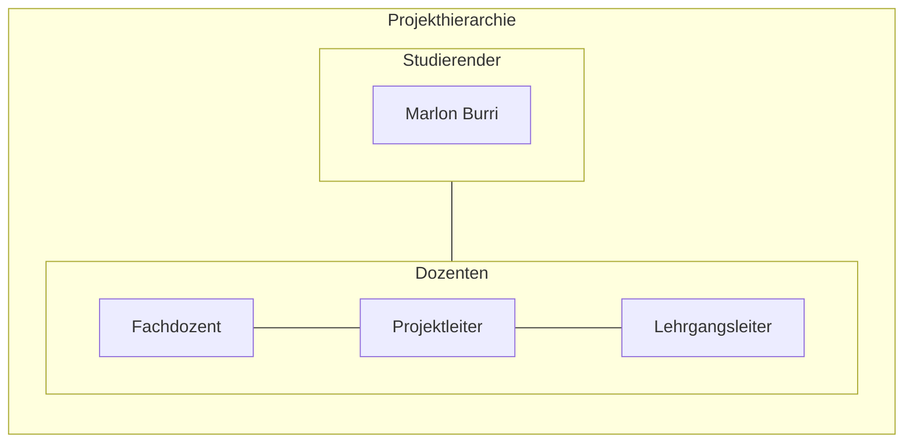

# Cloud Control Panel für AWS – Ressourcen effizient verwalten

*Das Image wurde mit Adobe Firefly erstellt.*

# Inhaltsverzeichnis

[toc]

## 1 Einleitung

In diesem Projekt wird ein Bash-basiertes Control Panel für AWS entwickelt, das eine einfache und effiziente Verwaltung sowie Administration von Cloud-Ressourcen ermöglicht. Diese Arbeit basiert auf dem erarbeiteten Fachwissen aus dem ersten Semester des Lehrgangs zum dipl. Informatiker HF mit Vertiefung in Cloud Native. Diese Arbeit wurde von Marlon Burri geschrieben und ist eine Einzelarbeit.

## 1.1 Behandelte Module

- AWS-Base
- Infrastructure as Code
- Projektmanagement

# 2 Projektorganisation

## 2.1 Problemstellung
Mit meinem AWS-Control Panel lassen sich Ressourcen wie EC2-Instanzen, VPCs, Security Groups und mehr vollständig automatisiert per Skript erstellen und verwalten. 
Der entscheidende Vorteil dabei, die Nutzung der AWS-Weboberfläche wird nahezu überflüssig. 
In Kombination mit Cloud-init lassen sich einsatzbereite Systeme automatisch bereitstellen und konfigurieren. 

## 2.2 Aufgabenstellung

## 2.3 Ziele

### 2.3.1 Effizienzsteigerung und Automatisierung
Entwicklung eines Control Panel für AWS-Ressourcen mithilfe von Infrastructure-as-Code (IaC). 
Dabei sollen EC2-Instanzen, Netzwerke (VPCs, Subnets, Gateways), Security Groups und weitere AWS-Komponenten durch Code automatisch erstellt, konfiguriert und verwaltet werden. 
Ziel ist es, manuelle Arbeitsschritte vollständig zu eliminieren und die Bereitstellung zu standardisieren.

## 2.4 Terminplan

## 2.5 Sachmittel

## 2.6 Vorgaben, Methoden und Werkzeuge

### 2.6.1 Projektmanagementmethod

### 2.6.2 Versionierungskonzept

### 2.6.3 Arbeitsumgebung

### 2.6.4 Nicht Teil des Projektes

### 2.6.5 Risikoanalyse

## 2.7 Projekt Sprints

# 3 Projektplan

# 4 Architekturdiagramm

# 5 Lösungsdesign