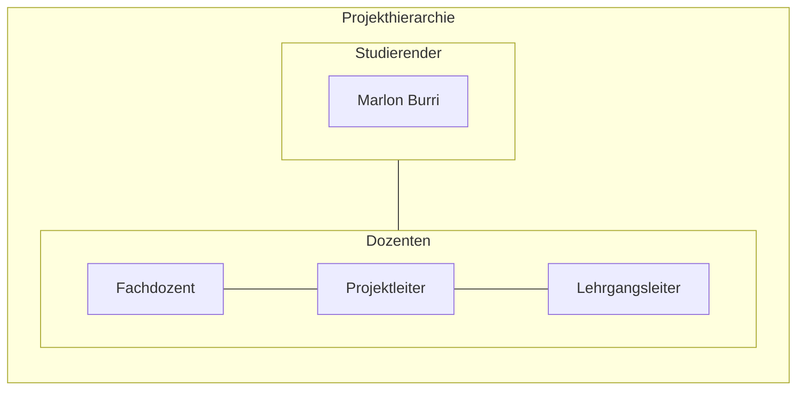
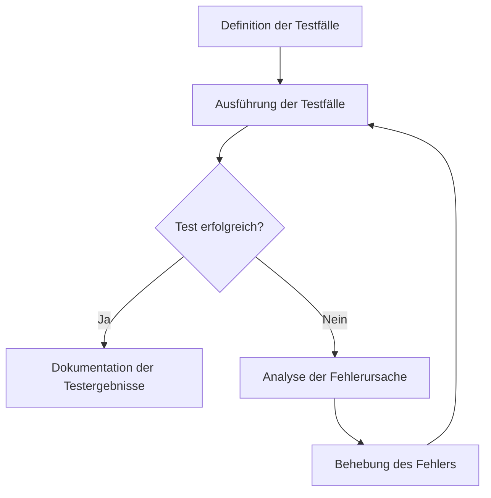
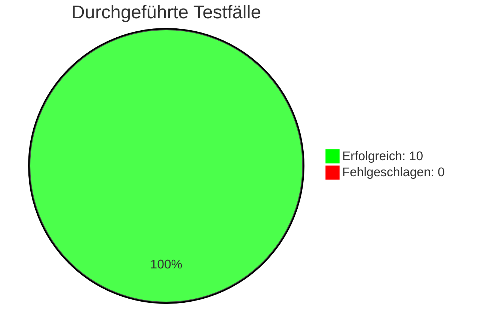

# Cloud Control Panel für AWS – Ressourcen effizient verwalten


*Das Image wurde mit Adobe Firefly erstellt.*

# Inhaltsverzeichnis

[toc]

&nbsp;

## 1 Einleitung

In diesem Projekt wird ein Bash[^20]-basiertes Control Panel für AWS entwickelt, das eine einfache und effiziente Verwaltung sowie Administration von Cloud-Ressourcen ermöglicht. Diese Arbeit basiert auf dem erarbeiteten Fachwissen aus dem ersten Semester des Lehrgangs zum dipl. Informatiker HF mit Vertiefung in Cloud Native. Diese Arbeit wurde von Marlon Burri geschrieben und ist eine Einzelarbeit.


## 1.1 Behandelte Module

- AWS-Cloud
- Infrastructure as Code
- Projektmanagement

# 2 Projektorganisation



## 2.1 Problemstellung

Mit meinem AWS-Control Panel lassen sich Ressourcen wie EC2-Instanzen[^3], VPCs[^4], Security Groups[^6] vollständig automatisiert per Script erstellen und verwalten. Als wir im AWS-Cloud Modul vermehrt EC2-Instanzen sowie die dazugehörigen VPCs und Subnetze[^5] manuell erstellen musste, wurde mir schnell klar, dass dieser Prozess automatisiert werden muss. So entstand die Idee zum Control Panel. Der entscheidende Vorteil dabei ist, dass die Nutzung der AWS-Weboberfläche nahezu überflüssig wird. In Kombination mit Cloud-init lassen sich einsatzbereite Systeme automatisch bereitstellen und konfigurieren.


## 2.2 Aufgabenstellung

Basierend auf der Problembeschreibung ist das Ziel dieses Projekts die Entwicklung eines Control Panels zur Verwaltung und Bereitstellung von AWS-Ressourcen. 
Das System soll es ermöglichen, EC2-Instanzen, VPCs, Security Groups und weitere Cloud-Ressourcen vollständig per Script zu erstellen und zu verwalten, wodurch die Nutzung der AWS-Weboberfläche weitgehend überflüssig gemacht wird. 
Diese Automatisierung soll effizient, fehlerfrei und schnell erfolgen. Für die Umsetzung wird AWS-CLI[^1], Bash und Cloud-init[^7] verwendet. 
Der gesamte Prozess der Ressourcenbereitstellung und Verwaltung wird durch Scripte automatisiert welche sicherstellen, dass alle notwendigen Aufgaben effizient und ohne manuelle Eingriffe durchgeführt werden.

## 2.3 Ziele

* __Effizienzsteigerung und Automatisierung:__
Entwicklung eines Control Panel für die Verwaltung von AWS-Ressourcen mithilfe von Infrastructure-as-Code (IaC)[^8]. 
Dabei sollen EC2-Instanzen, Netzwerke (VPCs, Subnets, Gateways), Security Groups und weitere AWS-Ressourcen durch Code automatisch erstellt, konfiguriert und verwaltet werden. 
Ziel ist es, manuelle Arbeitsschritte vollständig zu eliminieren und die Bereitstellung zu automatisieren.

* __Unabhängigkeit von der Weboberfläche:__
Vollständige Steuerung und Verwaltung von AWS-Ressourcen über die Shell mit Scripte welche mittels Bash auf die AWS CLI zugreiffen. 
Die Notwendigkeit, die AWS Management Console zu nutzen, soll entfallen, um die Verwaltung und Bereitstellung der Ressourcen effizienter und einfacher zu gestalten.

* __Standardisierung und Wiederverwendbarkeit:__
Aufbau einer strukturierten IaC-Codelogik mit wiederverwendbaren Templates und Parametern für verschiedene AWS-Komponenten. 
Dadurch können identische Setups mehrfach verwendet und standardisiert werden. 
Die Lösung soll versioniert über GitLab[^19] verwaltet werden, um Änderungen nachvollziehbar zu dokumentieren.


## 2.4 Terminplan
Zur Planung des Projektablaufs wird in Jira[^18] ein Gantt-Chart verwendet. 
Dieses dient dazu, eine Übersicht und zeitliche Strukturierung der User Stories zu erhalten. 
Änderungen können flexibel vorgenommen werden, was eine sofortige Anpassung des Plans ermöglicht. 
Das Tool wird eingesetzt, da es im agilen Projektmanagement üblich ist, dass es zu Veränderungen kommt. 
Die Jira-Timeline visualisiert diese Änderungen unmittelbar und ermöglicht so einen optimalen Überblick über den Projektverlauf.

**Der Zeitplan für die Projektsprints sieht wie folgt aus:**
| Sprint           | Titel                                                                | Zeitraum                     | Ziel                                                                        |
|------------------|----------------------------------------------------------------------|------------------------------|-----------------------------------------------------------------------------|
| Sprint 1         | Grundlagen und Initialisierung                                       | 05.05.25 – 19.05.25          | Projektstruktur, Planung, AWS-Zugriffe einrichten, erstes Basis Script.     |
| Sprint 2         | Netzwerkautomatisierung, Server Deployment und Automatisierung       | 19.05.25 – 02.06.25          | Automatisierte Erstellung der Infrastruktur (Instanzen, VPCs, Subnets etc.).|
| Sprint 3         | Optimierung und Bedienbarkeit und Testing                            | 02.06.25 – 16.06.25          | Code verbessern, Logging[^10] und Fehlerbehandlung[^11] einbauen, erste Tests.        |
| Sprint 4         | Dokumentation Nachbearbeitung                                        | 16.06.25 – 30.06.25          | Finales Testing und Dokumentation abschliessen.                             |
| Sprint 5         | Finalisierung der Semesterarbeit                                     | 30.06.25 – 09.07.25          | Dokumentation Prüfen und Projekt abgabebereit machen.                 |

&nbsp;

## 2.5 Sachmittel

* AI-Tools (Chatgpt, Gemini, Copilot etc.)
* AWS-Academy
* AWS-CLI
* Bash
* Cloud-init
* Git
* Gitlab
* Jira
* Markdown
* Mermaid Markdown
* VS-Code

## 2.6 Vorgaben, Methoden und Werkzeuge

__Projektmethodik:__  

Für die Umsetzung des Projekts wird SCRUM[^14] als agile Projektmanagementmethode verwendet. 
Die Entwicklung erfolgt iterativ wodurch regelmässige Zwischenergebnisse abgeliefert und überprüft werden können. 
Bei Bedarf kann am Ende jeder Iteration das weitere Vorgehen angepasst werden. 

__Versionierungskonzept:__  

Gitlab wird zur Dokumentation und Nachverfolgung von Änderungen verwendet. 
Die Projektdateien werden in diesem Gitlab-Repository verwaltet. 
Die komplette Dokumentation des Projekts wird fortlaufend in einer Markdown Datei innerhalb des Repositories erstellt und mit den Commit Messages ergänzt. 

__Arbeitsumgebung:__  

Die Umsetzung der Arbeit erfolgt lokal auf meinem Laptop. Der Bash-Code wird dort entwickelt und anschliessend in mein GitLab-Projekt gepusht.
Über die AWS-CLI werden die benötigten Ressourcen in der AWS-Cloud erstellt, verwaltet und aufgerufen.
Als Code-Editor kommt Visual Studio Code zum Einsatz. Zur Veranschaulichung habe ich mit draw.io eine schematische Darstellung meiner Arbeitsumgebung erstellt.


*Visualisierung meiner Arbeitsumgebung.*
&nbsp;

__Test und Validierung:__  

Die Validierung des Codes findet Vortlaufend während der Entwicklung statt. Am Ende des Projekts werden zusätzlich Testfälle definiert um die Funktionsfähigkeit Final zu Messen. 

__Nicht Teil des Projektes:__  

Das Bereitstellen von weiteren Ressourcen, abgesehen von EC2-Instanzen, VPCs, Security Groups usw. ist nicht vorgesehen. Im Rahmen des Projekts werden Ressourcen ausschliesslich per Script erstellt und gelöscht. Vorgänge wie das Umbenennen, Duplizieren oder Erweitern von Ressourcen erfolgt nicht automatisiert und ist auch nicht Bestandteil des Projekt.

__Risikoanalyse:__  

Im Rahmen dieses Projekts wurde eine Risikoanalyse durchgeführt und in der folgenden Matrix visualisiert. Dabei wurden potenzielle Risiken identifiziert und dokumentiert. 
Zu jedem Risiko wurde eine passende Massnahme definiert, die entweder im Falle des Eintritts des Risikos ergriffen oder präventiv im Vorhinein umgesetzt wird.  

Das Risikolevel wird durch die Bewertung der Eintrittswahrscheinlichkeit und der Auswirkung eines Risikos auf einer Skala von 1 bis 5 definiert und anschliessend zusammengerechnet. 
Die Eintrittswahrscheinlichkeit gibt an, wie wahrscheinlich es ist, dass ein bestimmtes Risiko tatsächlich eintritt. Sie wird auf einer Skala von 1 (niedrig) bis 5 (sehr hoch) bewertet.
Die Auswirkung beschreibt, wie gravierend die Folgen sind, wenn das Risiko tatsächlich eintritt. Sie wird ebenfalls auf einer Skala von 1 (niedrig) bis 5 (sehr hoch) bewertet. *(Dieser Text wurde mithilfe von ChatGPT geschrieben, 2025).* 
&nbsp;

Das Risiko-Level  wird in folgende Gruppen Eingestuft:
* 🔴 __Sehr hoch__ (Risiko-Level 15–25)
* 🟠 __Hoch__ (Risiko-Level 10–14)
* 🟡 __Mittel__ (Risiko-Level 5–9)
* 🟢 __Niedrig__ (1–4)  


*Screenshot von meiner Risiko Matrix aus data/RisikoMatrix.xlsx.*  

&nbsp;
&nbsp;

| Risiko-ID | Beschreibung                                                                    | Wahrscheinlichkeit | Auswirkung   | Risiko-Level | Farbe            | Massnahmen                                                           |
|-----------|---------------------------------------------------------------------------------|--------------------|--------------|--------------|------------------|----------------------------------------------------------------------|
| R1        | Script löscht versehentlich Ressourcen ohne Rückfrage                           | 2 (niedrig)        | 2 (niedrig)  | 4            | 🟢Niedrig       | --confirm-Abfrage einbauen, dry-run verwenden, Logging aktivieren    |
| R2        | IAM-Rollen sind unzureichend konfiguriert                                       | 2 (niedrig)        | 3 (hoch)     | 6            | 🟡Mittel        | IAM-Rollen prüfen und anpassen, Least-Privilege-Prinzip umsetzen     |
| R3        | Scriptfehler durch fehlende Validierung oder Error Handling                     | 3 (mittel)         | 3 (mittel)   | 9            | 🟡Mittel        | set -e, trap, und Code regelmässig Validieren                        |                  |
| R4        | Unkontrollierte Ressourcenerstellung                                            | 3 (mittel)         | 4 (hoch)     | 12           | 🟠Hoch          | Ressourcen mit Tags versehen, regelmässige Bereinigung               |
| R5        | Falsch konfigurierter Code mit sensiblen Daten oder fehlerhaften Berechtigungen | 3 (mittel)         | 5 (sehr hoch)| 15           | 🔴Sehr hoch     | Zugangsdaten nicht als Klartext speichern, SSH-Keys für EC2 nutzen   |

&nbsp;


# 3 Projektplan

Für die Semesterarbeit wurde kein klassischer Gantt-Projektplan erstellt. Die Durchführung erfolgt vollständig nach SCRUM wesshalb es im Verlauf vom Projekt zu Änderungen am Projektplan kommen könnte. Die Aufgaben wurden in User Stories aufgeteilt und in fünf Sprints gegliedert, wobei für jeden Sprint ein klares Ziel festgelegt wurde. Um dennoch eine visuelle Planung darzustellen, wurde die Timeline vom Projekt in Jira genutzt.

Diese kann über folgenden Link aufgerufen werden: [Jira Timeline](https://marlon-burri.atlassian.net/jira/software/projects/SCRUM/boards/1/timeline)

__Platzhalter Screenshot Jira Timeline__

Die Timeline bietet einen strukturierten Überblick über alle geplanten Sprints. Änderungen an Tasks oder User Stories werden in Echtzeit sichtbar, was die Visualisierung der Projektumsetzung erleichtert.  

In Scrum werden Anforderungen hierarchisch gegliedert, um komplexe Aufgaben übersichtlich zu strukturieren. 
Epics bilden dabei die oberste Ebene. Sie beschreiben grosse, übergeordnete Anforderungen, die mehrere Sprints umfassen und in kleinere User Stories unterteilt werden. 
User Stories stellen konkrete Anforderungen aus Sicht des Nutzers dar und sind so formuliert, dass sie innerhalb eines Sprints umgesetzt werden können. 
Zur weiteren Aufteilung und besseren Planung können User Stories in Subtasks untergliedert werden. 
Das sind kleinere technische oder organisatorische Aufgaben, die für die Umsetzung der jeweiligen Story notwendig sind. *(Dieser Text wurde mithilfe von ChatGPT geschrieben, 2025).*  

```
Projekt
└── Epic
    └── User Story
        └── Subtask
```

&nbsp;

## 3.1 Bestandteile User Story
Eine User Story[^15] ist eine zentrale Einheit im agilen Arbeiten. Sie beschreibt kein einzelnes Feature, sondern ein spezifisches, kleines Endziel aus Sicht des Anwenders. Dabei handelt es sich um eine klare und leicht verständliche Beschreibung einer Aufgabe, die einem bestimmten Muster folgt. User Storys werden meist in einem einfachen Satz formuliert, der den Zweck deutlich macht. Die typische Struktur lautet:

> „Als [Rolle] möchte ich [Ziel], damit [Nutzen].“  

Dieses Muster wurde konsequent für alle User Storys in diesem Projekt verwendet. Im Screenshot ist ein Beispiel einer User Story aus meinem Projekt dargestellt.

&nbsp;

  
*Screenshot einer User Story*  
&nbsp;

Weitere wichtige Bestandteile einer User Story sind die Akzeptanzkriterien, die festlegen, wann eine Story als erfüllt gilt. Ebenso sollten Abhängigkeiten zu anderen Teams oder Tasks klar beschrieben werden. Ausserdem ist das Einhalten der Definition of Done (DoD)[^16] entscheidend, um sicherzustellen, dass alle Qualitätsanforderungen erfüllt sind. Bevor eine User Story in einen Sprint aufgenommen wird, erfolgt ausserdem eine Aufwandsschätzung in Form von Story Points, um den Umfang besser planen zu können.

&nbsp;

## 3.2 Definition of Ready (DoR)

Die Definition of Ready[^17] besteht aus individuell festgelegten Kriterien, die definieren, welche Voraussetzungen eine User Story im Product Backlog erfüllen muss, bevor sie in einen Sprint aufgenommen werden kann. 
Sie stellt sicher, dass das Team ein gemeinsames Verständnis der Aufgabe hat und diese realistisch umsetzbar ist.

* __Inhaltliche Anforderungen:__ Die User Story enthält eine vollständige Beschreibung mit allen relevanten Informationen, und das Ziel der Story ist klar definiert. Zudem sind alle notwendigen Akzeptanzkriterien formuliert, und die Story wurde vom Product Owner gegengelesen.

* __Technische Anforderungen:__ Alle technischen Abhängigkeiten wurden identifiziert. Externe Abhängigkeiten sind, falls erforderlich dokumentiert. Zudem ist klar definiert, welche Ressourcen benötigt werden (z.B. Datenbanken, Server usw.).

* __Planbarkeit:__ Die Story ist so zugeschnitten, dass sie innerhalb eines Sprints umgesetzt werden kann. Falls erforderlich, wurde sie in Tasks oder Subtasks aufgeteilt. Alle betroffenen Teams und Stakeholder wurden informiert, und es bestehen keine offenen Unklarheiten oder Blocker, die die Umsetzung behindern.

Die Definition of Ready gilt einheitlich für alle User Stories im Projekt und wird nicht individuell in die Beschreibung einzelner Stories eingefügt.

&nbsp;

## 3.3 Definition of Done (DoD)

Die Definition of Done setzt sich aus individuell festgelegten Kriterien zusammen, die definieren, wann eine User Story als vollständig abgeschlossen gilt. Sie schafft ein einheitliches Verständnis von Qualität innerhalb des Teams.

* __Umsetzung der Anforderungen:__ Alle Anforderungen und Akzeptanzkriterien der User Story sind vollständig umgesetzt und funktionieren gemäss den Vorgaben.

* __Testabdeckung:__ Die User Story ist vollständig und erfolgreich getestet. Alle Akzeptanzkriterien wurden erfüllt.

* __Dokumentation:__ Alle relevanten Änderungen und Konfigurationen sind dokumentiert. Die Dokumentation ist aktuell und für das Team zugänglich.

* __Betriebs- und Supportprozess:__ Falls erforderlich, wurde ein Prozess für den Betrieb und Support eingerichtet, um eine reibungslose Übergabe und Nachverfolgbarkeit sicherzustellen.

In JIra wurde eine Automation Rule erstellt, welche die Kriterien der Definition of Done (DoD) automatisch in das Beschreibungsfeld eingefügt, sobald ein neues Backlog Item erstellt wird.

&nbsp;

## 3.4 Projekt Sprints

### 3.4.1 Sprint 1

Ziel des ersten Sprints ist es, die Grundlagen und Voraussetzungen für das Projekt zu schaffen. 
Dazu gehören unter anderem die Erstellung einer Risikoanalyse, die Planung des weiteren Vorgehens sowie die Dokumentation der Organisationsstruktur. 
Am Ende des ersten Sprints sollen alle notwendigen Vorarbeiten geleistet sein, sodass mit der eigentlichen Umsetzung gestartet werden kann.

__Sprint Planning:__  

Zu Beginn musste der Aufwand von den am höchsten priorisierten User Stories anhand von Storypoints geschätzt werden. 
Da im Rahmen dieser Arbeit nur eine einzelne Person das SCRUM-Team bildet, ist ein separates Backlog Refinement nicht sinnvoll.
Die Schätzung der Storypoints erfolgt daher direkt im Sprint Planning. 

Im Sprint Planning wurde zunächst ermittelt, wie viel Kapazität anhand von Storypoints zur Verfügung steht. 
Für den ersten Sprint wurde ein Ziel von fünf Storypoints gesetzt. Ein Storypoint entspricht dabei einem Arbeitstag mit acht Stunden Aufwand. 
Entsprechend werden Aufgaben mit einem Gesamtaufwand von fünf Storypoints eingeplant. 

Im Anschluss wurde in Jira der erste Sprint erstellt, welcher vom 5. Mai bis zum 19. Mai 2025 läuft. 
Abschliessend wurden falls erforderlich, Subtasks zu den Stories angelegt, um die Aufgaben besser strukturieren und aufteilen zu können.  


*Screenshot von meinem Sprint 1 Backlog in Jira.*

__Sprint Review:__ 

In der Sprint Review wurden die Ergebnisse des ersten Sprints vorgestellt und gemeinsam mit dem Projektmanagement-Lehrer Projektleiter besprochen. Dabei wurde gezielt Feedback eingeholt, um die weitere Projektarbeit zu verbessern. 

Ein wesentlicher Diskussionspunkt war die Deklaration von Inhalten, die mithilfe von künstlicher Intelligenz (KI) erstellt wurden. Es wurde festgelegt, dass solche Inhalte eindeutig deklariert und die verwendeten Prompts im Quellenverzeichnis aufgeführt werden sollen.
Zudem wurde darüber diskutiert, ob zusätzlich zur Jira-Timeline ein Gantt-Diagramm erstellt werden soll, um den Projektplan visuell darzustellen. Nach gemeinsamer Absprache wurde entschieden, dass die Visualisierung über die Jira-Timeline ausreichend ist und somit kein separates Gantt-Diagramm erstellt wird. 

Insgesamt konnte der erste Sprint erfolgreich abgeschlossen werden, und die definierten Sprintziele wurden erreicht. Ziel war es, nach dem ersten Sprint mit der eigentlichen Umsetzung der Scripte beginnen zu können. 
Dafür mussten zunächst alle notwendigen Vorbereitungen getroffen und abgeschlossen werden. Darüber hinaus wurde bereits im Voraus das Datum für das Sprint Review des zweiten Sprints festgelegt.  


Abgeschlossene User Storys:  

* [SCRUM-10, Einleitung und Projektorganisation](https://marlon-burri.atlassian.net/jira/software/projects/SCRUM/boards/1/timeline?selectedIssue=SCRUM-10)✅-DONE
* [SCRUM-11, Risikoanalyse](https://marlon-burri.atlassian.net/jira/software/projects/SCRUM/boards/1/timeline?selectedIssue=SCRUM-11)✅-DONE
* [SCRUM-12, Lösungsdesign](https://marlon-burri.atlassian.net/jira/software/projects/SCRUM/boards/1/timeline?selectedIssue=SCRUM-12)✅-DONE
* [SCRUM-13, Architektur](https://marlon-burri.atlassian.net/jira/software/projects/SCRUM/boards/1/timeline?selectedIssue=SCRUM-13)✅-DONE
* [SCRUM-30, DoR und DoD](https://marlon-burri.atlassian.net/jira/software/projects/SCRUM/boards/1/timeline?selectedIssue=SCRUM-30)✅-DONE
* [SCRUM-34, Projektplan](https://marlon-burri.atlassian.net/jira/software/projects/SCRUM/boards/1/timeline?selectedIssue=SCRUM-34)✅-DONE


*Screenshot von meiner Timeline nach dem ersten Sprint.*

### 3.4.2 Sprint 2

__Sprint Planning:__

Seit dem letzten Mal, als die verbleibenden User Stories im Backlog betrachtet wurden, wurde das Projekt grob geplant und die Stories erstellt. Jedoch waren sie zu diesem Zeitpunkt noch nicht im Detail beschrieben.

Daher bestand der erste Schritt darin, für alle User Stories aussagekräftige Beschreibungen zu verfassen und passende Akzeptanzkriterien zu definieren, um eine klare Grundlage für die Umsetzung zu schaffen. Anschliessend wurde anhand der Story Points ermittelt, wie viel Kapazität zur Verfügung steht. Für den zweiten Sprint wurden User Stories im Gesamtumfang von fünf Story Points eingeplant.

Zum Abschluss wurde in Jira der zweite Sprint erstellt, welcher vom 19. Mai bis zum 2. Juni 2025 läuft. Zusätzlich wurden für einige User Stories Sub-Tasks angelegt, um die Aufgaben innerhalb der Stories besser aufteilen und effizienter bearbeiten zu können.


*Screenshot von meinem Sprint 2 Backlog in Jira.*

__Sprint Review:__

Im zweiten Sprint Review wurde eine kurze Live-Demo des im Sprint fertiggestellten Control Panels präsentiert. Der Fokus lag auf kleineren Navigationsschritten innerhalb des Panels,
da aus zeitlichen Gründen keine umfangreichere Demonstration möglich war.  

Im Anschluss holte ich Feedback von Ceasar Roth (Projektmanagement-Lehrperson) ein. Er wies mich darauf hin, dass nach jedem Sprint eine kurze Zusammenfassung in Form von 
2–3 Sätzen erfolgen soll. In dieser sollte festgehalten werden, ob das Sprintziel erreicht wurde und welche User Stories abgeschlossen sind. 
Er gab mir ausserdem stichwortartige Hinweise, was eine gute Sprint Review beinhalten sollte. Diese Punkte habe ich aufgenommen und direkt in meine Sprint Review integriert,
um den formalen und inhaltlichen Anforderungen besser zu entsprechen.

Der zweite Sprint konzentrierte sich vollständig auf die Umsetzung der Scripte. Ziel war es, ein erstes funktionsfähiges Control Panel zu entwickeln, das die grundlegenden Anforderungen des Projekts erfüllt.
Das Sprintziel wurde vollständig erreicht, alle eingeplanten User Stories sowie die zugehörigen Subtasks konnten erfolgreich umgesetzt werden.
In [Abschnitt 5](https://gitlab.com/semesterarbeiten1/1-semester/aws-controlpanel#5-umsetzung) der Projektdokumentation, der sich mit der technischen Umsetzung befasst, wurden sämtliche Arbeitsschritte nachvollziehbar dokumentiert, 
inklusive relevanter Codeausschnitte und unterstützender Screenshots. Als Nächstes steht das Testen sowie die Erweiterung und Optimierung einzelner Funktionen der Scripte an. 

Abgeschlossene User Storys:  

* [SCRUM-16, EC2-Instance handling](https://marlon-burri.atlassian.net/jira/software/projects/SCRUM/boards/1/timeline?selectedIssue=SCRUM-16)✅-DONE
* [SCRUM-15, Infrastruktur Automatisierung](https://marlon-burri.atlassian.net/jira/software/projects/SCRUM/boards/1/timeline?selectedIssue=SCRUM-15)✅-DONE
* [SCRUM-17, Server Konfiguration](https://marlon-burri.atlassian.net/jira/software/projects/SCRUM/boards/1/timeline?selectedIssue=SCRUM-17)✅-DONE
* [SCRUM-23, Control Panel](https://marlon-burri.atlassian.net/jira/software/projects/SCRUM/boards/1/timeline?selectedIssue=SCRUM-23)✅-DONE


*Screenshot von meiner Timeline nach dem zweiten Sprint.*

### 3.4.3 Sprint 3

__Sprint Planning:__

Der dritte Sprint befasst sich mit dem Testen sowie der Erweiterung des im vorherigen Sprint erstellten Control Panels. 
Ziel ist es, am Ende ein möglichst benutzerfreundliches und funktionales Control Panel bereitzustellen, mit dem sich AWS-Ressourcen einfach, effizient und übersichtlich verwalten lassen.

Am Montag, dem 26.05.2025, fand eine Besprechung mit meinem Fachexperten Fachdozent statt. Er empfahl mir, die Scripte strukturiert in verschiedene Verzeichnisse (z.B. bin, var, log usw.) zu organisieren. 
Zusätzlich riet er dazu, die Scripte mit relokalisierbaren Pfaden auszustatten, sodass sie unabhängig vom Ausführungsort funktionieren. 
Ausserdem betonte er, dass die Scripte eigenständig lauffähig sein sollen und nicht zwingend vom Hauptscript abhängig sein sollen.

Dieses Feedback habe ich aufgenommen und in das Sprint Backlog eingearbeitet. Die erste Aufgabe im Sprint bestand daher darin, entsprechende User Stories zu formulieren und einzuplanen. 
Für diesen Sprint wurde erneut eine Kapazität von fünf Story Points festgelegt, die auf die einzelnen User Stories verteilt wurden. Der dritte Sprint geht vom 2. Juni bis zum 16. Juni 2025.


*Screenshot von meinem Sprint 3 Backlog in Jira.*

__Sprint Review:__

Zu Beginn der Sprint Review wurden die abgeschlossenen User Stories präsentiert und der aktuelle Stand der Arbeit aufgezeigt. 
Der dritte Sprint konnte erfolgreich abgeschlossen werden, sodass mir in den kommenden Wochen noch ausreichend Zeit bleibt, einen sauberen Projektabschluss vorzubereiten und bei einzelnen Punkten der Bewertungsmatrix weitere Verbesserungen vorzunehmen.

Zu diesem Zweck habe ich gemeinsam mit der Lehrperson die Bewertungsmatrix durchgesehen. Dabei wurde deutlich, dass insbesondere Punkt 5, die Reflexionstiefe, noch Optimierungspotenzial bietet. 
Konkret wurde bemängelt, dass in meinen bisherigen Sprint Reviews zu wenig auf mögliche Vorbehalte gegenüber meiner Lösung eingegangen wurde. 
Ebenso fehlte eine kritische Auseinandersetzung mit alternativen Lösungsansätzen oder Programmiersprachen, die sich ebenfalls für die Umsetzung der Semesterarbeit geeignet hätten.
Insgesamt bin ich jedoch sehr zufrieden mit der bisher geleisteten Arbeit und blicke zuversichtlich auf den Abschluss der Semesterarbeit. 
Das Sprint-Ziel von Sprint 3 wurde vollständig erreicht, alle geplanten User Stories konnten erfolgreich umgesetzt werden.

Im nächsten Sprint steht die Finalisierung der Arbeit im Fokus. Dabei geht es vor allem um die Fertigstellung des Projektabschlusses sowie um die sorgfältige Kontrolle und Überarbeitung der gesamten Arbeit.

Abgeschlossene User Storys:  

* [SCRUM-19, Logging einbauen](https://marlon-burri.atlassian.net/browse/SCRUM-19)✅-DONE
* [SCRUM-20, Fehlerbehandlung verbessern](https://marlon-burri.atlassian.net/browse/SCRUM-20)✅-DONE
* [SCRUM-21, Design überarbeiten](https://marlon-burri.atlassian.net/browse/SCRUM-21)✅-DONE
* [SCRUM-22, Bedienbarkeit Prüfen](https://marlon-burri.atlassian.net/browse/SCRUM-22)✅-DONE
* [SCRUM-61, Testing durchführen](https://marlon-burri.atlassian.net/browse/SCRUM-61)✅-DONE


*Screenshot von meiner Timeline nach dem dritten Sprint.*

### 3.4.4 Sprint 4

__Sprint Planning:__

Wie vor jedem Sprint mussten zunächst alle User Storys gemäss der [Definition of Done (DoD)](https://gitlab.com/semesterarbeiten1/1-semester/aws-controlpanel#32-definition-of-ready-dor) 
vollständig und korrekt vorbereitet werden. Ziel des vierten Sprints war es, die letzten Schritte zur Fertigstellung der Semesterarbeit umzusetzen. Dazu gehörten insbesondere der 
Projektabschluss mit technischem und persönlichem Fazit sowie das Verfassen des Schlussworts.

Zusätzlich wurde eine separate User Story erstellt, welche die abschliessende Prüfung der Quellen sowie die Überarbeitung des Glossars beinhaltete. 
Nach Abschluss dieses Sprints sollte die Semesterarbeit in einem abgabereifen Zustand sein.

Der vierte Sprint wurde für den Zeitraum vom __16. Juni bis 30. Juni 2025__ angesetzt und entsprechend in Jira erfasst. 
Die dazugehörigen User Storys wurden ins Sprint Backlog verschoben. Wie in den vorherigen Sprints wurde die verfügbare Kapazität mit __fünf Story Points__ festgelegt 
und auf die einzelnen Aufgaben verteilt.


*Screenshot von meinem Sprint 4 Backlog in Jira.*

__Sprint Review:__

Die Sprint Review des vierten Sprints wurde eigenständig und ohne Beteiligung der Fachlehrperson durchgeführt. Im Rahmen der Review wurde überprüft, ob alle User Stories gemäss der Definition of Done (DoD) erfolgreich abgeschlossen wurden.

Der Fokus des vierten Sprints lag auf dem Verfassen eines technischen sowie persönlichen Fazits, der Überprüfung aller Quellenangaben und dem Erstellen des Glossars. Ziel war es, die Semesterarbeit nach Abschluss dieses Sprints abgabebereit zu haben, dieses Ziel wurde vollständig erreicht.

Im nächsten und letzten Sprint steht nur noch der Feinschliff an. Dieser umfasst die grammatikalische Korrektur des Textes sowie das optionale Ergänzen einzelner Inhalte, falls notwendig.

* [SCRUM-26, Fazit schreiben](https://marlon-burri.atlassian.net/browse/SCRUM-26)✅-DONE
* [SCRUM-62, Projektabschluss](https://marlon-burri.atlassian.net/browse/SCRUM-62)✅-DONE
* [SCRUM-27, Glossar und Quellen Prüfen](https://marlon-burri.atlassian.net/browse/SCRUM-27)✅-DONE
* [SCRUM-25, Dokumentation ergänzen](https://marlon-burri.atlassian.net/browse/SCRUM-25)✅-DONE
* [SCRUM-28, Dokumentation überprüfen](https://marlon-burri.atlassian.net/browse/SCRUM-28)✅-DONE


*Screenshot von meiner Timeline nach dem vierten Sprint.*

### 3.4.5 Sprint 5

__Sprint Planning:__

Der fünfte und letzte Sprint befasst sich mit der Finalisierung der Semesterarbeit. Ziel ist es nach diesem Sprint die Semesterarbeit vollständig und abgabebereit zu haben. Es werden einzelne Feinschliffe noch gemacht falls nötig und der ganze Text und Code auf die richtigkeit geprüft. Der Sprint startet am __30. Juni__ und geht bis und mit dem __9. Juli 2025__ wobei dies auch gerade das Abgebedatum des Projekts ist.

__Sprint Review:__

# 4 Lösungsdesign

## 4.1 Main Script

  

*Flowchart – Main-Script | Erstellt von: Marlon Burri | Stand: 16.05.2025 | Version: 1.0 | Tool: draw.io*

## 4.2 EC2 Script

  

*Flowchart – EC2-Script | Erstellt von: Marlon Burri | Stand: 16.05.2025 | Version: 1.0 | Tool: draw.io*

## 4.3 VPC Script

  

*Flowchart – VPC-Script | Erstellt von: Marlon Burri | Stand: 16.05.2025 | Version: 1.0 | Tool: draw.io*

## 4.4 Subnet Script

  

*Flowchart – Subnet-Script | Erstellt von: Marlon Burri | Stand: 16.05.2025 | Version: 1.0 | Tool: draw.io*

# 5 Umsetzung

__Main Script:__

Mit der effektiven Entwicklung des Codes wurde im zweiten Sprint begonnen. Die erste User Story dieses Sprints ([SCRUM-23](https://marlon-burri.atlassian.net/jira/software/projects/SCRUM/boards/1?selectedIssue=SCRUM-23&sprintStarted=true)) umfasste die Entwicklung des Main-Script, das als Hauptmenü dient, sowie der zugehörigen Submenüs (EC2-Menu, VPC-Menu usw.). 
Das Main-Script wurde schrittweise aufgebaut, um ein benutzerfreundliches Control Panel zu bereitzustellen. Die Idee, den Titel mithilfe von ASCII-Zeichen darzustellen, entstand spontan und verleiht dem Projekt ein gewisses Wiedererkennungsmerkmal. 
Für das Design kam die Star-Wars-Schriftart aus dem ASCII-Generator von [Patorjk](https://patorjk.com/software/taag/#p=display&f=Star%20Wars&t=Type%20Something%20) zum Einsatz.

Zu Beginn wurden die Variablen und Farbdefinitionen in separate Scripts ausgelagert, um eine zentrale und wiederverwendbare Struktur für alle weiteren Scripts zu schaffen. 
Anschliessend wurde ein Hauptmenü entwickelt, das dem Benutzer verschiedene Auswahlmöglichkeiten wie EC2, VPC, Subnetze und Security Groups bietet. 
Jede dieser Kategorien ist über ein eigenes Script organisiert. Das Vorgehen basiert auf einer klaren Trennung der Funktionalitäten (Modularisierung[^9]) und kann beliebig erweitert werden, um eine noch Benutzerfreundliche Bedienung zu gewährleisten

```bash
#!/bin/bash

# variables
source "$(dirname "$0")/colors.bash"
source "$(dirname "$0")/variables.bash"

# header 
print_header() {
    clear
    echo -e "${BOLD_YELLOW}"
    echo "      ___   ____    __    ____   _______.     ______   ______   .__   __. .___________..______        ______    __         .______      ___      .__   __.  _______  __      "
    echo "     /   \  \   \  /  \  /   /  /       |    /      | /  __  \  |  \ |  | |           ||   _  \      /  __  \  |  |        |   _  \    /   \     |  \ |  | |   ____||  |     "
    echo "    /  ^  \  \   \/    \/   /  |   (----\`   |  ,----'|  |  |  | |   \|  | \`---|  |----\`|  |_)  |    |  |  |  | |  |        |  |_)  |  /  ^  \    |   \|  | |  |__   |  |     "
    echo "   /  /_\  \  \            /    \   \       |  |     |  |  |  | |  . \`  |     |  |     |      /     |  |  |  | |  |        |   ___/  /  /_\  \   |  . \`  | |   __|  |  |     "
    echo "  /  _____  \  \    /\    / .----)   |      |  \`----.|  \`--'  | |  |\   |     |  |     |  |\  \----.|  \`--'  | |  \`----.   |  |     /  _____  \  |  |\   | |  |____ |  \`----."
    echo " /__/     \__\  \__/  \__/  |_______/        \______| \______/  |__| \__|     |__|     | _| \`._____| \______/  |_______|   | _|    /__/     \__\ |__| \__| |_______||_______|"
    echo -e "${NC}"
    
    echo -e "${WHITE}"
    echo "╔══════════════════════════════════════════════════════════════╗"
    echo "║                       AWS-ControlPanel v1.0                  ║"
    echo "╠══════════════════════════════════════════════════════════════╣"
    echo "║ Author       : Marlon Burri (marlob03)                       ║"
    echo "║ Purpose      : Manage and automate AWS resources             ║"
    echo "║ Features     : EC2, VPC, Subnets, Security Groups            ║"
    echo "║ Environment  : Bash CLI interface with modular structure     ║"
    echo "║ Session Info : $USER@$HOSTNAME | $DATE             ║"
    echo "╚══════════════════════════════════════════════════════════════╝"
    echo -e "${NC}"
}


# menu 
show_menu() {
    echo -e "${BOLD_BLUE}"
    echo "1. EC2-Menu"
    echo "2. VPC-Menu"
    echo "3. Subnet-Menu"
    echo "4. SecurityGroup-Menu"
    echo "5. Exit"
    echo -e "${NC}"
}

# input
read_input() {
    read -rp "Please select an option: " choice
    case "$choice" in
        1)
            echo -e "${BOLD_YELLOW}You selected EC2-Menu. Loading EC2 options...${NC}"
            bash "$(dirname "$0")/ec2_menu.bash"
            ;;
        2)
            echo -e "${BOLD_YELLOW}You selected VPC-Menu. Loading VPC options...${NC}"
            bash "$(dirname "$0")/vpc_menu.bash"
            ;;
        3)
            echo -e "${BOLD_YELLOW}You selected Subnet-Menu. Loading Subnet options...${NC}"
            bash "$(dirname "$0")/subnet_menu.bash"
            ;;
        4)
            echo -e "${BOLD_YELLOW}You selected SecurityGroup-Menu. Loading Security Group options...${NC}"
            bash "$(dirname "$0")/securitygroup_menu.bash"
            ;;
        5)
            echo -e "${BOLD_YELLOW}Exiting program. Goodbye!${NC}"
            source "$(dirname "$0")/ascii_logo.bash"
            print_ascii_logo
            exit 0
            ;;
        *)
            echo -e "${RED}Invalid option. Please try again.${NC}"
            ;;
    esac
}


# pause
pause() {
    read -rp "Press [Enter] key to continue..."
}

# main loop
main() {
    while true; do
        print_header
        show_menu
        read_input
        pause
    done
}


# Only executes if it runs directly
if [[ "${BASH_SOURCE[0]}" == "${0}" ]]; then
    main
fi
```

> __Hinweis__: Dieses Script repräsentiert den aktuellen Arbeitsstand des Main-Script. Es befindet sich in aktiver Entwicklung und stellt noch nicht die endgültige Version dar.

&nbsp;


*Aktuelles Abbild – Main-Script | Erstellt von: Marlon Burri | Stand: 25.05.2025 | Version: 1.0*

&nbsp;

__EC2 Menu Script:__  

Das EC2-Script übernimmt die vollständige Bereitstellung, Konfiguration sowie das Löschen von EC2-Instanzen. Es beinhaltet die gleichen Variablen wie das Main-Script und ist ähnlich aufgebaut. Das Script bietet dem Benutzer ein übersichtliches Menü zur Auswahl verschiedener Operationen, darunter das Erstellen, Anzeigen und Löschen von EC2-Instanzen.

Der Header ist bewusst schlicht gehalten, ohne eine ASCII-Schriftzug jedoch wird dennoch klar anzeigt, in welchem Menü sich der Benutzer befindet.
Bei der Auswahl einer Option wird ein separater Bash-Prozess gestartet, der das jeweils referenzierte Unterscript ausführt (z. B. ```ec2_create.bash```, ```ec2_list.bash```, ```ec2_delete.bash```). Nach Abschluss des Prozesses gibt das Script eine Zusammenfassung der ausgeführten Aktion aus und kehrt nach bestätigung des Anwenders ins EC2-Menü zurück.

Zur Ausführung des Scripts wurde eine Hauptschleife definiert. Die Funktion ruft in einer Endlosschleife wiederholt folgende vier Funktionen auf:

```print_header``` – zeigt den Menü-Kopf an.

```show_menu``` – listet die verfügbaren Optionen auf.

```handle_input``` – verarbeitet die Benutzereingabe.

```pause``` – hält das Script kurz an, bis der Benutzer eine Taste drückt.

Der ```if```-Block am Ende sorgt dafür, dass die Funktion nur ausgeführt wird, wenn das Script direkt aufgerufen wird, nicht wenn es von einem anderen Script importiert oder gesourced wird. Das macht das Script modular und wiederverwendbar.

```bash
#!/bin/bash

# variables
source "$(dirname "$0")/init_env.bash"

# menu
show_menu() {
    echo -e "${BOLD_BLUE}"
    echo "1. Create EC2 Instance"
    echo "2. List EC2 Instances"
    echo "3. Delete EC2 Instance"
    echo "4. Create new full EC2 Environment"
    echo "5. Back to Main Menu"
    echo "6. Exit Program"
    echo -e "${NC}"
}

# pause
pause() {
    read -rp "Press [Enter] to continue..."
}

# handle input
handle_input() {
    read -rp "Select an option: " choice
    case "$choice" in
        1)
            echo -e "${BOLD_YELLOW}Loading EC2 creation process...${NC}"
            bash "$(dirname "$0")/ec2_create.bash"
            ;;
        2)
            echo "Listing EC2 instances..."
            bash "$(dirname "$0")/ec2_list.bash"
            ;;
        3)
            echo -e "${BOLD_YELLOW}Loading EC2 deletion process...${NC}"
            bash "$(dirname "$0")/ec2_delete.bash"
            ;;
        4)
            echo "Creating new full EC2 environment..."
            bash "$(dirname "$0")/ec2_fullenviroment.bash"
            ;;
        5)
            echo "Returning to Main Menu..."
            source "$(dirname "$0")/main.bash"
            exit 0
            ;;
        6)
            echo -e "${BOLD_YELLOW}Exiting program. Goodbye!${NC}"
            source $LIBDIR/ascii_logo.bash
            print_ascii_logo
            kill $PPID
            exit 0
            ;;
        *)
            echo -e "${RED}Invalid option.${NC}"
            ;;
    esac
}


# main loop
main_ec2_menu() {
    while true; do
        print_header
        show_menu
        handle_input
        pause
    done
}

# Only executes if it runs directly
if [[ "${BASH_SOURCE[0]}" == "${0}" ]]; then
    main_ec2_menu
fi
```

> __Hinweis__: Dieses Script repräsentiert den aktuellen Arbeitsstand des EC2-Script. Es befindet sich in aktiver Entwicklung und stellt noch nicht die endgültige Version dar.

&nbsp;

  
*Aktuelles Abbild – EC2-Script | Erstellt von: Marlon Burri | Stand: 30.05.2025 | Version: 1.0*

&nbsp;

Alle weiteren Submenüs wie ```vpc_menu.bash```, ```subnet_menu.bash``` und ```securitygroup_menu.bash``` wurden nach dem gleichen Schema wie das ```EC2_menu.bash``` entwickelt. Sie sind modular aufgebaut und können bei Bedarf auch unabhängig vom Main-Script ausgeführt werden.

Hinter jedem dieser Menüscripte stehen weitere Einzelscripte, die konkrete Aufgaben übernehmen wie z.B das Erstellen oder Löschen einer EC2-Instanz. Wählt der Benutzer eine entsprechende Option im Menü, wird er zur Eingabe relevanter Parameter aufgefordert, wie beispielsweise dem Namen der Instanz. Alternativ lassen sich diese Parameter auch direkt über die Kommandozeile beim Einzelaufruf der jeweiligen Scripte übergeben, was eine flexible und automatisierte Nutzung ermöglicht.

&nbsp;

__Server Konfiguration:__   

Beim Erstellprozess einer EC2-Instanz besteht die Möglichkeit, das System mithilfe von cloud-init automatisch zu konfigurieren. Der darin enthaltene Konfigurationscode wird jeweils beim Start des Systems ausgeführt und kann verschiedene Einrichtungsschritte automatisieren. Die Konfigurationsdateien enden mit der Dateiendung ```.yaml``` und beginnen mit der Direktive ```#cloud-config```. Das cloud-init-Konfigurationstemplat beinhalten unter anderem die Erstellung meines persönlichen Benutzers (marlob), welcher der sudo-Gruppe zugewiesen ist. Dieser Benutzer kann sich neben dem hinterlegten SSH-Key auch über ein im Template hinterlegtes, als Hash gespeichertes Passwort authentifizieren.

Zusätzlich werden automatisch die SSH Keys von zwei Lehrpersonen und mir im Standard-User (ubuntu) auf der Instanz hinterlegt. Das Einfügen dieser SSH-Keys dient ausschliesslich der Veranschaulichung, wie eine Zusammenarbeit mehrerer Benutzer auf einem System organisiert werden könnte. Für die Bewertung meiner Semesterarbeit ist es jedoch nicht erforderlich, dass die Lehrpersonen Zugriff auf die Systeme haben.

Darüber hinaus werden wichtige Pakete wie vim und curl automatisch installiert.
Aus sicherheitstechnischen Gründen wird am Ende des cloud-init-Templates die erneute Ausführung von cloud-init auf dem System deaktiviert, um unbeabsichtigte Änderungen bei zukünftigen Neustarts zu verhindern.

```yaml
#cloud-config

users:
  - name: marlob
    sudo: ALL=(ALL) NOPASSWD:ALL
    groups: sudo
    homedir: /home/marlob
    shell: /bin/bash
    lock_passwd: false
    passwd: <sha512-crypt-hash-of-your-password>
    ssh_authorized_keys:
      - ssh-rsa AAAAB3NzaC1yc2EAAAADAQABAAACAQDSAgeAmyw8sIph8AWkngIf3DomfsbEvzj6ErBmeUmhPjNd4H8d9FfWUKoarpQpjB1HEFL2krbWlldBO+e4t8Ckds+1RqobFeXLeoI91XXyEEWR+WY3dfRUAgBAtXDlOoWSU6uq8Shsg62EUQSKE9diHKujt07TYDyNv1hfN1rcJWzktrCPuxCVBDQdjtornhssl0dY1//uO5OwkGHiDUPSwCFmMoB5oJqBx8trqrAkX8sudKzzykv+WmFEVCzRjVe6j5Q1iiqzkMrHeSyp/RH2R1f4bXqKbeA0CoFcApa0A7Wvkd33ig5BE5NpqUjy99sRKN1zAYAI1JHZOKgy6wLaCjLnibkAbmhUKW0C2J4MeF8s2pPCqIlDCK6+bMkA6bIdtxW93cCI8C6qaNr35hwT9wH8XQ3JHW2GEEPNZZ5vfwMPs+7kjxl8BQRSGPcpbSGylZ7xnUmiCpq+UKLdyA/Am70xyWJ70hVwJPndbwAZ3FyzPnAYS4J8dnF+1Xmt1dFkv9dYtJbfGuOAZ7Q9TVWax01OIvb8yb/FEObjlDbTx4C491iTLizsFYfE4vRcT0HEE/qUQhdr8/7Iq17cVadAZaLScvXVhVpKJaF0GcEN+6VnUR2Fa4X2EZZoZRHHKqr3G/qa3avP4dNW6rq3wyfhZKTQBcRHGzgUAQ0Evo9ItQ== marlo@PC-BURRI
  

  - name: ubuntu
    sudo: ALL=(ALL) NOPASSWD:ALL
    groups: sudo
    homedir: /home/ubuntu
    shell: /bin/bash
    passwd: np
    ssh_authorized_keys:
      - ssh-rsa AAAAB3NzaC1yc2EAAAADAQABAAACAQDSAgeAmyw8sIph8AWkngIf3DomfsbEvzj6ErBmeUmhPjNd4H8d9FfWUKoarpQpjB1HEFL2krbWlldBO+e4t8Ckds+1RqobFeXLeoI91XXyEEWR+WY3dfRUAgBAtXDlOoWSU6uq8Shsg62EUQSKE9diHKujt07TYDyNv1hfN1rcJWzktrCPuxCVBDQdjtornhssl0dY1//uO5OwkGHiDUPSwCFmMoB5oJqBx8trqrAkX8sudKzzykv+WmFEVCzRjVe6j5Q1iiqzkMrHeSyp/RH2R1f4bXqKbeA0CoFcApa0A7Wvkd33ig5BE5NpqUjy99sRKN1zAYAI1JHZOKgy6wLaCjLnibkAbmhUKW0C2J4MeF8s2pPCqIlDCK6+bMkA6bIdtxW93cCI8C6qaNr35hwT9wH8XQ3JHW2GEEPNZZ5vfwMPs+7kjxl8BQRSGPcpbSGylZ7xnUmiCpq+UKLdyA/Am70xyWJ70hVwJPndbwAZ3FyzPnAYS4J8dnF+1Xmt1dFkv9dYtJbfGuOAZ7Q9TVWax01OIvb8yb/FEObjlDbTx4C491iTLizsFYfE4vRcT0HEE/qUQhdr8/7Iq17cVadAZaLScvXVhVpKJaF0GcEN+6VnUR2Fa4X2EZZoZRHHKqr3G/qa3avP4dNW6rq3wyfhZKTQBcRHGzgUAQ0Evo9ItQ== marlo@PC-BURRI
      - ssh-rsa AAAA...replace-with-a-team-member-key teammate@example.com
      - ssh-rsa AAAA...replace-with-a-team-member-key teammate@example.com

ssh_pwauth: true
disable_root: false
package_update: true 
packages:
  - curl
  - wget
  - vim
  - nano 
  - htop
  - net-tools

runcmd:
  - sudo touch /etc/cloud/cloud-init.disabled
```
*Aktuelles Abbild – Template_Ubuntu.yaml | Erstellt von: Marlon Burri | Stand: 31.05.2025 | Version: 1.0*

&nbsp;

__Logging Funktion:__  

Zur strukturierten Ausgabe von Statusmeldungen und Fehlermeldungen kommt im Script eine einfache Logging-Funktion zum Einsatz.
Die Funktion ```log()``` schreibt Nachrichten mit einem Zeitstempel und einem Schweregrad (z. B. ```INFO```, ```ERROR```, ```DEBUG```) in eine definierte Logdatei sowie auch auf die Konsole. Die Ausgabe richtet sich nach dem konfigurierten Logging-Level (```$LOGLEVEL```). So kann beispielsweise festgelegt werden, dass nur Fehlermeldungen (```ERROR```) oder auch allgemeine Informationen (```INFO```) und Debug-Ausgaben (```DEBUG```) protokolliert werden. Dadurch wird das Script transparenter und besser nachvollziehbar, insbesondere bei der Fehleranalyse oder bei automatisierten Abläufen wie das erstellen einer Ressource in AWS. Die definierte Logdatei (```$LOGFILE```) erleichtert zudem die spätere Auswertung und Dokumentation der ausgeführten Aktionen.

```bash
# logging Configuration 
LOGFILE="$LOGDIR/aws-control.log"  
LOGLEVEL="INFO"                     

# logging function 
log() {
    local level="$1"
    local message="$2"
    local timestamp
    timestamp=$(date +"%Y-%m-%d %H:%M:%S")

    
    if [[ "$level" == "ERROR" || "$level" == "$LOGLEVEL" || "$LOGLEVEL" == "DEBUG" ]]; then
        echo "[$timestamp] [$level] $message" >> "$LOGFILE"
        echo -e "[$timestamp] [$level] $message"
    fi
}
```
*Aktuelles Abbild – variables.bash / logging function | Erstellt von: Marlon Burri | Stand: 15.06.2025 | Version: 1.0*

&nbsp;

__Task scripts:__ 

In meinem Projekt wurden die Scripte in zwei Hauptkategorien unterteilt: Menu-Scripte und Task-Scripte. Die Menu-Scripte befinden sich im Ordner ```bin``` und dienen der grafisch unterstütztung und Darstellung von Auswahlmöglichkeiten innerhalb der Kommandozeilenoberfläche. Sie bilden sozusagen das interaktive Frontend des Tools und führen die Benutzer/innen durch das Menüsystem.

Die Task-Scripte hingegen liegen im Ordner ```scripts``` übernehmen die eigentliche Umsetzung der gewünschten Funktionen, wie etwa das Erstellen, Löschen oder Auflisten von AWS-Ressourcen z.B EC2-Instanzen, Security Groups, Subnetzen usw. Diese Scripte wurden nach einem klar definierten und wiederverwendbaren Aufbauprinzip entwickelt. Dadurch können sie nicht nur vom Hauptmenü aus aufgerufen, sondern auch völlig eigenständig und isoliert ausgeführt werden. Das ist besonders hilfreich beim Debugging, bei Tests oder für den gezielten Einsatz in automatisierten Prozessen.

Jedes Task-Script beginnt mit dem Laden einer zentralen Initialisierungsdatei[^12] (```init_env.bash```), die für eine einheitliche Umgebung sorgt. Anschliessend erfolgt ein strukturierter Logeintrag, um Startzeit und Scriptname zu dokumentieren. Die eigentliche Logik ist in einer klar benannten Funktion gekapselt, was die Lesbarkeit und die Wartung vereinfacht. Fehlerbehandlung, Nutzereingaben und Rückgabewerte sind standardisiert umgesetzt. Zusätzlich wird durch eine vorgelagerte Funktionsprüfung (```check_aws_requirements```) sichergestellt, dass notwendige Voraussetzungen wie gültige Credentials oder die Verfügbarkeit der AWS CLI erfüllt sind. Diese strukturierte Trennung und der modulare Aufbau sorgen nicht nur für eine hohe Wartbarkeit, sondern auch für Flexibilität im Umgang mit den einzelnen Komponenten des Projekts. Um den strukturellen Aufbau exemplarisch darzustellen wurde das ```securitygroup_delete.bash``` genommen, das genau nach diesem Prinzip aufgebaut ist und tadellos funktioniert.

```bash
#!/bin/bash
source "$(dirname "${BASH_SOURCE[0]}")/../lib/init_env.bash"

log "INFO" "Starting Script: $(basename "$0")"

# delete Security Group
delete_security_group() {
    #read -rp "Enter the AWS region: " region

    #if [[ -z "$AWS_REGION" ]]; then
        #log "ERROR" "Region was not specified."
        #echo "Region is required."
        #return 1
    #fi

    #get security group
    echo "Fetching existing Security Groups in region '$AWS_REGION'..."
    aws ec2 describe-security-groups \
        --region "$AWS_REGION" \
        --query "SecurityGroups[*].{ID:GroupId,Name:GroupName,Description:Description,VPC:VpcId}" \
        --output table

    read -rp "Enter the Security Group ID to delete (e.g., sg-0abc1234def567890): " sg_id

    if [[ -z "$sg_id" ]]; then
        log "ERROR" "Security Group ID has not been set."
        echo "Security Group ID is required."
        return 1
    fi

    log "INFO" "Try to delete Security Group '$sg_id' in Region '$AWS_REGION'..."
    echo "Deleting Security Group '$sg_id'..."

    if aws ec2 delete-security-group --group-id "$sg_id" --region "$AWS_REGION"; then
        log "SUCCESS" "Security Group '$sg_id' deleted successfully."
        echo "Security Group '$sg_id' deleted successfully."
    else
        log "ERROR" "Error deleting the security group '$sg_id'. Possibly in use or incorrect ID."
        echo "Failed to delete Security Group. It might be in use or the ID is incorrect."
        return 1
    fi

    return 0
}

# run functions
check_aws_requirements
delete_security_group

# end of script
```
*Aktuelles Abbild – securitygroup_delete.bash | Erstellt von: Marlon Burri | Stand: 15.06.2025 | Version: 1.0*

&nbsp;

# 6 Testverfahren

Für die Durchführung des Testing wurde ein strukturierter Ablauf festgelegt, um sicherzustellen, dass alle Testfälle vollständig und erfolgreich abgeschlossen werden.


&nbsp;

Getestet werden die jeweiligen Prozesse zur Erstellung und Löschung von AWS-Ressourcen, wie z. B. EC2-Instanzen oder Security Groups, sowie deren Funktionalität und Ablauf im Terminal. Alle Testfälle sind so konzipiert, dass sie gemeinsam die definierten Projektziele vollständig abdecken. Ein erfolgreiches Bestehen aller Testfälle bestätigt die korrekte Umsetzung des AWS-Controlpanels.

Die Tests werden ausschliesslich in der definierten Projektumgebung durchgeführt. Diese befindet sich auf meinem vorhandenen Laptop, wie in der Projektbeschreibung definiert.

## 6.1 Testfälle

| Testfall 1             | Start des Hauptmenüs über `main.bash`                                                                                            |
|------------------------|----------------------------------------------------------------------------------------------------------------------------------|
| Voraussetzungen        | - Bash ist installiert<br>- AWS CLI ist konfiguriert<br>- Zugriff auf das lokale Repository mit allen Scripten                   |
| Erwartetes Ergebnis    | Das Hauptmenü wird im Terminal angezeigt.<br> Es stehen Auswahlmöglichkeiten wie EC2, VPC, Subnet und Security Group zur Verfügung.  |
| Testablauf             | 1. Terminal öffnen<br>2. Im Projektverzeichnis `./bin/main.bash` ausführen<br>3. Menüauswahl wird sichtbar.                      |
| Effektives Ergebnis    | Menü erscheint und reagiert auf Benutzereingabe                                                                                  |
| Screenshotg / Logfiles | <br>*GIF Main-Menu Script*                                                                |
| Problemstellungen      | -                                                                                                                                |
| Testergebnis           | Erfolgreich                                                                                                                      |

&nbsp;

| Testfall 2             | Navigation ins EC2-Menü über Hauptmenü                                       |
|------------------------|------------------------------------------------------------------------------|
| Voraussetzungen        | - Hauptmenü ist geöffnet                                                     |
| Erwartetes Ergebnis    | EC2-Menü wird geladen und zeigt EC2-spezifische Aktionen an.                 |
| Testablauf             | 1. Hauptmenü starten<br>2. Option „EC2“ auswählen                            |
| Effektives Ergebnis    | EC2-Menü erscheint                                                           |
| Screenshotg / Logfiles | <br>*GIF EC2-Menu Script*             |
| Problemstellungen      | -                                                                            |
| Testergebnis           | Erfolgreich                                                                  |

&nbsp;

| Testfall 3              | Löschen einer Security Group über `securitygroup_delete.bash`                                                                                      |
|------------------------|-----------------------------------------------------------------------------------------------------------------------------------------------------|
| Voraussetzungen        | - AWS CLI ist konfiguriert<br>- Benutzer hat Berechtigungen zum Löschen von Security Groups<br>- Eine Security Group existiert.                     |
| Erwartetes Ergebnis    | Die angegebene Security Group wird erfolgreich gelöscht.                                                                                            |
| Testablauf             | 1. Terminal öffnen<br>2. Script `./scripts/securitygroup_delete.bash` ausführen<br>3. Bestehende SGs anzeigen lassen<br>4. ID eingeben und löschen. |
| Effektives Ergebnis    | Security Group wird gelöscht und Erfolgsmeldung angezeigt.                                                                                          |
| Screenshotg / Logfiles | <br>*Delete Security Group*                                                                                                                                                    |
| Problemstellungen      | - Security Group ist noch in Verwendung                                                                                                             |
| Testergebnis           | Erfolgreich / Fehler bei in Benutzung befindlicher SG                      |

&nbsp;

| Testfall 4              | Fehlende Eingabe einer Security Group ID                                  |
|------------------------|----------------------------------------------------------------------------|
| Voraussetzungen        | - AWS CLI ist konfiguriert<br>- Script ist vorhanden                      |
| Erwartetes Ergebnis    | Das Script bricht ab und meldet, dass keine gültige ID eingegeben wurde.   |
| Testablauf             | 1. Script starten<br>2. Bei der Abfrage keine ID eingeben<br>3. Bestätigen |
| Effektives Ergebnis    | Fehlermeldung wird ausgegeben<br>Script wird abgebrochen                   |
| Screenshotg / Logfiles | <br>*GIF Wrong Input Script*                                                                            |
| Problemstellungen      | -                                                                          |
| Testergebnis           | Erfolgreich                                                                |

&nbsp;

| Testfall 5             | Erstellen einer EC2-Instanz                                               |
|------------------------|----------------------------------------------------------------------------|
| Voraussetzungen        | - AWS CLI konfiguriert<br>- Zugriff auf passende Subnet/Security Group   |
| Erwartetes Ergebnis    | Eine neue EC2-Instanz wird erstellt und angezeigt                         |
| Testablauf             | 1. EC2-Menü öffnen<br>2. Instanzparameter angeben<br>3. Erstellung starten |
| Effektives Ergebnis    | EC2-Instanz erscheint in der AWS-Konsole                                  |
| Screenshotg / Logfiles | <br>*EC2 creation*                                                                          |
| Problemstellungen      | - Falscher AMI oder fehlende Rechte                                       |
| Testergebnis           | Erfolgreich / Fehler erkannt                                              |

&nbsp;

| Testfall 6             | Löschen einer EC2-Instanz                                                 |
|------------------------|----------------------------------------------------------------------------|
| Voraussetzungen        | - EC2-Instanz existiert<br>- AWS CLI ist eingerichtet                     |
| Erwartetes Ergebnis    | Instanz wird beendet und gelöscht                                         |
| Testablauf             | 1. EC2-Menü öffnen<br>2. Instanz auswählen<br>3. Löschen bestätigen         |
| Effektives Ergebnis    | Instanz nicht mehr sichtbar                                                |
| Screenshotg / Logfiles | <br>*EC2 delete*                                                                          |
| Problemstellungen      | - Fehlende Berechtigung oder Instanz-ID falsch                            |
| Testergebnis           | Erfolgreich                                                                |

&nbsp;

| Testfall 7             | Erstellen eines Subnetzes                                                 |
|------------------------|----------------------------------------------------------------------------|
| Voraussetzungen        | - VPC existiert<br>- AWS CLI ist bereit                                   |
| Erwartetes Ergebnis    | Neues Subnetz wird angelegt                                               |
| Testablauf             | 1. Subnet-Script starten<br>2. VPC und CIDR angeben<br>3. Subnetz erstellen |
| Effektives Ergebnis    | Subnetz wird erfolgreich in AWS erstellt                                  |
| Screenshotg / Logfiles | <br>*Subnet creation*                                                                          |
| Problemstellungen      | - CIDR-Konflikte                                                           |
| Testergebnis           | Erfolgreich                                                                |

&nbsp;

| Testfall 8             | Auflisten aller Security Groups                                            |
|------------------------|----------------------------------------------------------------------------|
| Voraussetzungen        | - AWS CLI eingerichtet                                                     |
| Erwartetes Ergebnis    | Liste aller SGs wird im Terminal angezeigt                                |
| Testablauf             | 1. SG-Script starten<br>2. Liste anzeigen lassen                           |
| Effektives Ergebnis    | Übersicht im Terminal                                                      |
| Screenshotg / Logfiles | <br>*List Security Groups*                                                                          |
| Problemstellungen      | -                                                                          |
| Testergebnis           | Erfolgreich                                                                |

&nbsp;

| Testfall 9             | Logging der Scriptausgabe                                                  |
|------------------------|----------------------------------------------------------------------------|
| Voraussetzungen        | - `log()`-Funktion implementiert<br>- LOGLEVEL korrekt gesetzt             |
| Erwartetes Ergebnis    | Jeder Schritt wird mit Zeitstempel geloggt                                |
| Testablauf             | 1. Script mit Logging starten<br>2. Terminalausgabe prüfen<br>3. Logdatei kontrollieren |
| Effektives Ergebnis    | Logfile-Einträge vorhanden                                                 |
| Screenshotg / Logfiles | Logdatei: `aws-control.log`                                                |
| Problemstellungen      | <br>*Auszug vom Log* |                                                                 
| Testergebnis           | Erfolgreich                                                                |

&nbsp;

| Testfall 10            | Direkter Aufruf eines Task-Scripts ohne Hauptmenü                          |
|------------------------|----------------------------------------------------------------------------|
| Voraussetzungen        | - Zugriff auf Script<br>- AWS CLI konfiguriert                             |
| Erwartetes Ergebnis    | Task wird unabhängig vom Menü ausgeführt                                  |
| Testablauf             | 1. Terminal öffnen<br>2. Script direkt starten<br>3. Ergebnis prüfen       |
| Effektives Ergebnis    | Task wird ordnungsgemäss ausgeführt                                         |
| Screenshotg / Logfiles | <br>*List EC2*                                                                          |
| Problemstellungen      | -                                                                          |
| Testergebnis           | Erfolgreich                                                                |

&nbsp;

__Testresultat:__  
Alle definierten Tests waren erfolgreich. Das Resultat ist entsprechend in folgender Grafik dargestellt.




# 7 Projektabschluss

## 7.1 Technisches Fazit

Diese Semesterarbeit bietet eine solide technische Grundlage für die automatisierte Verwaltung von AWS-Ressourcen. 
Durch ein eigens entwickeltes Control Panel konnten Ressourcen in AWS effizient bereitgestellt, konfiguriert und gelöscht werden. 
Die modulare Scriptstruktur und die Benutzerfreundliche Eingabeführung erleichtern den Umgang mit der AWS-Infrastruktur erheblich 
und zeigen klar die Vorteile automatisierter Prozesse gegenüber manuellen Abläufen.

Trotz der funktionalen Umsetzung wirft das Projekt bei näherer Betrachtung Fragen hinsichtlich Skalierbarkeit und langfristiger Verwaltbarkeit auf. 
Ziel war es, ein Tool zu entwickeln, das komplett Unabhängig von der Weboberfläche funktioniert. Dieses Ziel wurde grundsätzlich erreicht,
allerdings mussten dafür bestimmte Parameter eingeschränkt oder mit Standardwerten versehen werden, etwa bei der Auswahl eines SSH-Keys oder der AWS-Region.
Da die Entwicklung in einer isolierten Testumgebung stattfand, bleibt offen, wie gut sich das Control Panel in realen Szenarien bewährt und welchen tatsächlichen Mehrwert es dort generiert.

Die Benutzerfreundlichkeit konnte durch die Reduktion konfigurierbarer Optionen deutlich verbessert werden. Einige Parameter müssen jedoch weiterhin manuell eingegeben werden, 
da keine praktikablen Standardwerte definiert werden konnten. Zukünftige Erweiterungen wie vordefinierte Profile oder dynamische Ressourcenabfragen bieten hier weiteres Optimierungspotenzial.
Insgesamt zeigt die Arbeit grossartig, wie sich Cloud-Ressourcen in AWS mithilfe eines eigenen Control Panels strukturiert und automatisiert verwalten lassen. 
Mit Blick auf Themen wie Sicherheit, Fehlerbehandlung und Mehrbenutzerfähigkeit bildet das Projekt eine wertvolle Grundlage für weiterführende Entwicklungen.

## 7.2 Persönliches Fazit

Die Arbeit an diesem Projekt war anspruchsvoll und forderte mich fachlich heraus. Gleichzeitig war es aber auch eine Gelegenheit zu persönlichen Weiterentwicklung.
Durch die Entwicklung eines eigenen AWS-Control Panels konnte ich mein Verständnis für die Automatisierung und Steuerung von Cloud-Ressourcen mit der AWS CLI und Bash-Scripten[^2] deutlich vertiefen. Der Aufbau eines übersichtlichen und funktionalen Control Panels erforderte nicht nur technisches Know-how, sondern auch ein gutes Gespür für Benutzerführung und Prozessgestaltung.

Ein wichtiger Punkt, der mir während der Umsetzung besonders bewusst wurde, war die klare Abgrenzung. Sei es bei der Auswahl und Verknüpfung von AWS-Diensten oder der automatisierten Erstellung von Ressourcen wie EC2-Instanzen, VPCs, Security Groups usw. Dabei zeigte sich, wie wichtig eine sorgfältige Planung und ein schrittweises, iteratives Vorgehen sind, um auch bei komplexeren Anforderungen den Überblick zu behalten und stabile Ergebnisse zu erzielen.

Trotz vieler positiver Erfahrungen hat das Projekt auch Grenzen aufgezeigt. Insbesondere hätte ich mir mehr Zeit gewünscht, um Aspekte wie die Skalierbarkeit der Ressourcen und die Erweiterbarkeit des Tools um noch mehr unabhängigkeit gegenüber der Weboberläche zu schaffen. Gleichzeitig war es genau diese Auseinandersetzung mit technischen Herausforderungen, die mir half, wichtige Soft Skills wie Ausdauer, Problemlösungskompetenz und strukturiertes Denken weiterzuentwickeln.

Insgesamt hat mir dieses Projekt gezeigt, wie erfüllend es sein kann, eine Lösung von Grund auf zu konzipieren und umzusetzen. Und wie wichtig es ist, stets offen für neue Technologien und Denkansätze zu bleiben, um sich sowohl fachlich als auch persönlich weiterzuentwickeln.

## 7.3 Mögliche Weiterentwicklung

Das Projekt bietet vielfältige Möglichkeiten zur Weiterentwicklung. Eine sinnvolle Erweiterung wäre die Einführung einer rollenbasierten Benutzer- und Rechteverwaltung, um den Zugriff auf bestimmte Funktionen gezielt steuern zu können und so den Einsatz im Arbeitsumfeld zu ermöglichen. Nebst dem schon bestehenden Logging würde auch die Integration von einer zusätzlichen Monitoring-Funktion zur besseren Nachvollziehbarkeit und Stabilität des Systems beitragen.

Darüber hinaus könnte das Tool um zusätzliche AWS-Dienste wie S3, RDS, IAM usw. erweitert werden, um eine ganzheitlichere Verwaltung der Cloud-Infrastruktur zu ermöglichen. Ebenso wäre es denkbar, Skalierungsfunktionen zu integrieren, mit denen komplexere Umgebungen welche mit mehreren EC2-Instanzen, Subnetzen oder Load Balancern, automatisch bereitgestellt werden könnten.

Ein weiterer Schritt in Richtung professioneller Infrastrukturverwaltung wäre die Anbindung an deklarative Tools wie z.B Terraform. Dadurch könnten wiederholbare, versionierbare und überprüfbare Deployments realisiert werden. In diesem Zusammenhang wäre auch der Einsatz von CI/CD-Pipelines[^13] sinnvoll, um die Bereitstellung und Aktualisierung des Control Panels sowie der zugrunde liegenden Infrastruktur automatisiert und kontrolliert ablaufen zu lassen. Dies würde die Wartbarkeit verbessern, manuelle Fehler reduzieren und die Entwicklung deutlich beschleunigen.

# 8 Schlusswort

Abschliessend lässt sich sagen, dass das AWS-Control Panel nicht nur eine funktionale Lösung zur Verwaltung von Cloud-Ressourcen darstellt, sondern auch eine wertvolle Lernerfahrung in Bezug auf Automatisierung, Strukturierung und den praktischen Umgang mit der AWS-CLI war. Die Umsetzung hat gezeigt, wie durchdachte Planung und kontinuierliche Verbesserung zu einem Werkzeug führen können, das sowohl technisch robust als auch benutzerfreundlich ist. Das Projekt bildet eine solide Grundlage für zukünftige Erweiterungen und bietet viele Ansatzpunkte, um es weiterzuentwickeln und noch stärker an professionelle Anforderungen anzupassen.

## 8.2 Quellenverzeichnis

* Adobe Firefly (2025, Mai 05). *Prompt: Amazon Web Service Control Panel* Adobe Firefly: https://firefly.adobe.com
* GitLab Flavored Markdown (GLFM) (2025, Mai 05): https://docs.gitlab.com/user/markdown/
* ChatGPT (2025, Mai 09). *Antwort von ChatGPT auf die Frage: Wir wird das Risiko-Level Berechnet?* ChatGPT: https://chatgpt.com
* ChatGPT (2025, Mai 12). *Antwort von ChatGPT auf die Frage: Wie ist das Backlog hierarchisch gegliedert?* ChatGPT: https://chatgpt.com
* Text to ASCII Art Generator (2025, Mai 22): https://patorjk.com/software/taag/#p=display&f=Graffiti&t=Type%20Something%20
* Mp4 to GIF-Converter (2025, Juni 15): https://www.adobe.com/de/express/feature/video/convert/video-to-gif

## 8.1 Glossar

[^1]: __AWS CLI__ ist ein Kommandozeilentool zur Verwaltung von AWS-Ressourcen. Es erlaubt das Ausführen von Befehlen zur Automatisierung von Aufgaben in der AWS-Cloud.  
[^2]: __Bash-Script__ ist ein in der Shell ausgeführtes Script, das Befehle automatisiert. In deinem Projekt bildet es das Fundament für das Control Panel.  
[^3]: __EC2-Instanz__ ist eine virtuelle Maschine in der AWS-Cloud, die verschiedene Aufgaben übernimmt, z. B. als Webserver oder Datenbankserver.  
[^4]: __VPC (Virtual Private Cloud__ ist ein isolierter Netzwerkbereich in AWS, in dem du deine Ressourcen betreiben kannst.  
[^5]: __Subnet__ ist ein Teilnetz innerhalb einer VPC, das IP-Adressen segmentiert und Routing strukturiert.  
[^6]: __Security Group__ ist eine virtuelle Firewall, die ein- und ausgehenden Datenverkehr für AWS-Ressourcen wie EC2-Instanzen regelt.  
[^7]: __Cloud-init__ ist ein Konfigurationssystem, das bei der Initialisierung von Cloud-Instanzen automatisch Konfigurationen und Installationen ausführt.  
[^8]: __Infrastructure as Code (IaC)__ ist ein Konzept, bei dem Infrastruktur mit Code definiert und versioniert wird.  
[^9]: __Modularisierung__ beschreibt die Strukturierung des Codes in eigenständige, wiederverwendbare Module (z. B. separate Scripte).  
[^10]: __Logging__ bedeutet die Protokollierung von Aktionen und Fehlermeldungen zur besseren Nachvollziehbarkeit und Fehlersuche.  
[^11]: __Fehlerbehandlung__ ist die strukturierte Erkennung und Reaktion auf Fehlerzustände im Script (z. B. falsche Eingaben, fehlende Ressourcen).  
[^12]: __Init-Script__ ist das zentrale Script zur Initialisierung der Umgebung, z. B. zur Festlegung von Farben, Variablen, Logging-Pfaden.  
[^13]: __CI/CD-Pipeline__ sind automatisierte Abläufe zur kontinuierlichen Integration und Bereitstellung (z. B. für Code-Updates oder Infrastrukturänderungen).  
[^14]: __SCRUM__ ist eine agile Projektmanagementmethode, bei der in kurzen, iterativen Zyklen (Sprints) gearbeitet wird.  
[^15]: __User Story__ ist eine Beschreibung aus Sicht eines Nutzers, die eine Funktion oder ein Ziel des Systems formuliert.  
[^16]: __Definition of Done (DoD)__ sind festgelegte Kriterien, wann eine Aufgabe oder User Story als vollständig erledigt gilt.  
[^17]: __Definition of Ready (DoR)__ sind Voraussetzungen, die erfüllt sein müssen, bevor eine User Story bearbeitet werden kann.  
[^18]: __Jira__ ist ein Projektmanagement-Tool zur Planung, Verwaltung und Visualisierung von Aufgaben und Sprints.  
[^19]: __Git / GitLab__ sind Versionsverwaltungssystem bzw. Plattform zur Quellcode-Verwaltung, Kollaboration und Nachverfolgung von Änderungen.
[^20]: __Bourne Again Shell (Bash)__ ist eine Unix-Shell und Scriptsprache, die häufig für die Automatisierung von Aufgaben und als Kommandozeile verwendet wird.