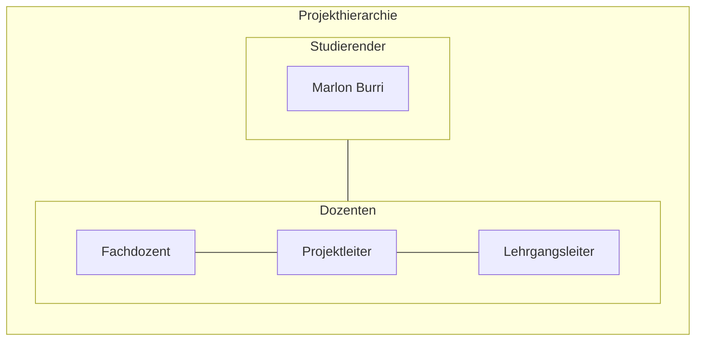

# Cloud Control Panel für AWS – Ressourcen effizient verwalten


*Das Image wurde mit Adobe Firefly erstellt.*

# Inhaltsverzeichnis

[toc]


## 1 Einleitung

In diesem Projekt wird ein Bash-basiertes Control Panel für AWS entwickelt, das eine einfache und effiziente Verwaltung sowie Administration von Cloud-Ressourcen ermöglicht. Diese Arbeit basiert auf dem erarbeiteten Fachwissen aus dem ersten Semester des Lehrgangs zum dipl. Informatiker HF mit Vertiefung in Cloud Native. Diese Arbeit wurde von Marlon Burri geschrieben und ist eine Einzelarbeit.


## 1.1 Behandelte Module

- AWS-Base
- Infrastructure as Code
- Projektmanagement

# 2 Projektorganisation



## 2.1 Problemstellung

Mit meinem AWS-Control Panel lassen sich Ressourcen wie EC2-Instanzen, VPCs, Security Groups und mehr vollständig automatisiert per Skript erstellen und verwalten. 
Der entscheidende Vorteil dabei, die Nutzung der AWS-Weboberfläche wird nahezu überflüssig. 
In Kombination mit Cloud-init lassen sich einsatzbereite Systeme automatisch bereitstellen und konfigurieren. 

## 2.2 Aufgabenstellung

Basierend auf der Problembeschreibung ist das Ziel dieses Projekts die Entwicklung eines Control Panels zur Verwaltung und Bereitstellung von AWS-Ressourcen. 
Das System soll es ermöglichen, EC2-Instanzen, VPCs, Security Groups und weitere Cloud-Ressourcen vollständig per Skript zu erstellen und zu verwalten, wodurch die Nutzung der AWS-Weboberfläche weitgehend überflüssig gemacht wird. 
Diese Automatisierung soll effizient, fehlerfrei und schnell erfolgen. Für die Umsetzung wird AWS-CLI, Bash und Cloud-init verwendet. 
Der gesamte Prozess der Ressourcenbereitstellung und Verwaltung wird durch Skripte automatisiert welche sicherstellen, dass alle notwendigen Aufgaben effizient und ohne manuelle Eingriffe durchgeführt werden.

## 2.3 Ziele

* __Effizienzsteigerung und Automatisierung:__
Entwicklung eines Control Panel für die Verwaltung von AWS-Ressourcen mithilfe von Infrastructure-as-Code (IaC). 
Dabei sollen EC2-Instanzen, Netzwerke (VPCs, Subnets, Gateways), Security Groups und weitere AWS-Ressourcen durch Code automatisch erstellt, konfiguriert und verwaltet werden. 
Ziel ist es, manuelle Arbeitsschritte vollständig zu eliminieren und die Bereitstellung zu automatisieren.

* __Unabhängigkeit von der Weboberfläche:__
Vollständige Steuerung und Verwaltung von AWS-Ressourcen über die Shell mit Skripte welche mittels Bash auf die AWS CLI zugreiffen. 
Die Notwendigkeit, die AWS Management Console zu nutzen, soll entfallen, um die Verwaltung und Bereitstellung der Ressourcen effizienter und einfacher zu gestalten.

* __Standardisierung und Wiederverwendbarkeit:__
Aufbau einer strukturierten IaC-Codelogik mit wiederverwendbaren Templates und Parametern für verschiedene AWS-Komponenten. 
Dadurch können identische Setups mehrfach verwendet und standardisiert werden. 
Die Lösung soll versioniert über GitLab verwaltet werden, um Änderungen nachvollziehbar zu dokumentieren.


## 2.4 Terminplan
Zur Planung des Projektablaufs wird in Jira ein Gantt-Chart verwendet. 
Dieses dient dazu, eine Übersicht und zeitliche Strukturierung der User Stories zu erhalten. 
Änderungen können flexibel vorgenommen werden, was eine sofortige Anpassung des Plans ermöglicht. 
Das Tool wird eingesetzt, da es im agilen Projektmanagement üblich ist, dass es zu Veränderungen kommt. 
Die Jira-Timeline visualisiert diese Änderungen unmittelbar und ermöglicht so einen optimalen Überblick über den Projektverlauf.

**Der Zeitplan für die Projektsprints sieht wie folgt aus:**
| Sprint           | Titel                                 | Zeitraum                     | Ziel                                                                      |
|------------------|---------------------------------------|------------------------------|---------------------------------------------------------------------------|
| Sprint 1         | Grundlagen und Initialisierung        | 05.05.25 – 19.05.25          | Projektstruktur, Planung, AWS-Zugriffe einrichten, erstes Basis Script.   |
| Sprint 2         | Netzwerkautomatisierung               | 19.05.25 – 02.06.25          | Automatisierte Erstellung der Infrastruktur (VPCs, Subnets, Routing etc.) |
| Sprint 3         | Server Deployment und Automatisierung | 02.06.25 – 16.06.25          | EC2-Instanzen automatisiert erstellen/löschen und konfigurieren.          |
| Sprint 4         | Optimierung und Bedienbarkeit         | 16.06.25 – 30.06.25          | Code verbessern, Logging und Fehlerbehandlung einbauen.                   |
| Sprint 5         | Finalisierung und Nachbearbeitung     | 30.06.25 – 09.07.25          | Finales Testing und Dokumentation abschliessen.                            |


## 2.5 Sachmittel

* AI-Tools (Chatgpt, Gemini, Copilot etc.)
* AWS-Academy
* AWS-CLI
* Bash
* Cloud-init
* Git
* Gitlab
* Jira
* Markdown
* Mermaid Markdown
* VS-Code

## 2.6 Vorgaben, Methoden und Werkzeuge

### 2.6.1 Projektmethodik
Für die Umsetzung des Projekts wird SCRUM als agile Projektmanagementmethode verwendet. 
Die Entwicklung erfolgt iterativ wodurch regelmässige Zwischenergebnisse abgeliefert und überprüft werden können. 
Bei Bedarf können am Ende der Iteration das weitere Vorgehen angepasst werden. 

### 2.6.2 Versionierungskonzept
Gitlab wird zur Dokumentation und Nachverfolgung von Änderungen verwendet. 
Die Projektdateien werden in einem Gitlab-Repository verwaltet. 
Die komplette Dokumentation des Projekts wird fortlaufend in einer Markdown Datei innerhalb des Repositories erstellt und mit den Commit Messages ergänzt. 

### 2.6.3 Arbeitsumgebung
Im Projekt wird die AWS-CLI mit Bash verwendet. Um die EC2-Instanzen zu konfigurieren, verwende Ich Cloud-init. 
Als Code Editor wird Visual Studio Code verwendet. 

### 2.6.4 Test und Validierung
Das Testing findet während jedem Sprint statt. Am Ende des Projekts werden zusätzlich Testfälle definiert um die Funktionsfähigkeit Final zu Messen. 

### 2.6.5 Nicht Teil des Projektes
Das Bereitstellen von weiteren Ressourcen, abgesehen von EC2-Instanzen, VPCs, Security Groups usw. ist nicht vorgesehen. Im Rahmen des Projekts werden Ressourcen ausschliesslich per Skript erstellt und gelöscht. 
Vorgänge wie das Umbenennen, Duplizieren oder Erweitern von Ressourcen erfolgt nicht automatisiert und ist auch nicht Bestandteil des Projekt.

### 2.6.6 Risikoanalyse

Im Rahmen dieses Projekts wurde eine Risikoanalyse durchgeführt und in der folgenden Matrix visualisiert. Dabei wurden potenzielle Risiken identifiziert und dokumentiert. 
Zu jedem Risiko wurde eine passende Massnahme definiert, die entweder im Falle des Eintritts des Risikos ergriffen oder präventiv im Vorhinein umgesetzt wird.  

Das Risikolevel wird durch die Bewertung der Eintrittswahrscheinlichkeit und der Auswirkung eines Risikos auf einer Skala von 1 bis 5 definiert und anschliessend zusammengerechnet. 
Die Eintrittswahrscheinlichkeit gibt an, wie wahrscheinlich es ist, dass ein bestimmtes Risiko tatsächlich eintritt. Sie wird auf einer Skala von 1 (sehr niedrig) bis 5 (sehr hoch) bewertet.
Die Auswirkung beschreibt, wie gravierend die Folgen sind, wenn das Risiko tatsächlich eintritt. Sie wird ebenfalls auf einer Skala von 1 (sehr niedrig) bis 5 (sehr hoch) bewertet. *(Dieser Text wurde mithilfe von ChatGPT geschrieben, 2025).* 
  
Das Risiko-Level  wird in folgende Gruppen Eingestuft:
* 🔴 __Hoch__ (Risiko-Level 15–25)
* 🟠 __Mittel__ (Risiko-Level 10–14)
* 🟡 __Niedrig–Mittel__ (Risiko-Level 5–9)
* 🟢 __Niedrig__ (1–4)


__Platzhalter Screenshot Excel__

| Risiko-ID | Beschreibung                                                                    | Wahrscheinlichkeit | Auswirkung   | Risiko-Level | Farbe            | Massnahmen                                                           |
|-----------|---------------------------------------------------------------------------------|--------------------|--------------|--------------|------------------|----------------------------------------------------------------------|
| R1        | Skript löscht versehentlich Ressourcen ohne Rückfrage                           | 3 (mittel)         | 4 (hoch)     | 12           | 🟠 Mittel        | --confirm-Abfrage einbauen, dry-run verwenden, Logging aktivieren    |
| R2        | IAM-Rollen sind unzureichend konfiguriert                                       | 2 (mittel)         | 3 (hoch)     | 6            | 🟡 Niedrig–Mittel| IAM-Rollen prüfen und anpassen, Least-Privilege-Prinzip umsetzen     |
| R3        | Skriptfehler durch fehlende Validierung oder Error Handling                     | 3 (hoch)           | 3 (mittel)   | 9            | 🟡 Niedrig–Mittel| set -e, trap, und Input-Validierung verwenden                        |
| R4        | Fehlkonfiguration von Ressourcen (z.B. VPCs oder Security Groups)               | 3 (mittel)         | 4 (sehr hoch)| 12           | 🟠 Mittel        | Code regelmässig validieren, automatische Tests                      |
| R5        | Unkontrollierte Ressourcenerstellung                                            | 3 (hoch)           | 4 (hoch)     | 12           | 🟠 Mittel        | Ressourcen mit Tags versehen, regelmässige Bereinigung               |
| R6        | Falsch konfigurierter Code mit sensiblen Daten oder fehlerhaften Berechtigungen | 3 (mittel)         | 5 (sehr hoch)| 15           | 🔴 Hoch          | Zugangsdaten nicht als Klartext speichern, SSH-Keys für EC2 nutzen   |

# 3 Projektplan

Für die Semesterarbeit wurde kein klassischer Gantt-Projektplan erstellt. Die Durchführung erfolgt vollständig nach SCRUM wesshalb es im Verlauf vom Projekt zu Änderungen am Projektplan kommen könnte. Die Aufgaben wurden in User Stories aufgeteilt und in fünf Sprints gegliedert, wobei für jeden Sprint ein klares Ziel festgelegt wurde. Um dennoch eine visuelle Planung darzustellen, wurde die Timeline vom Projekt in Jira genutzt.

Diese kann über folgenden Link aufgerufen werden: [Jira Timeline](https://marlon-burri.atlassian.net/jira/software/projects/SCRUM/boards/1/timeline)

Die Timeline bietet einen strukturierten Überblick über alle geplanten Sprints. Änderungen an Tasks oder User Stories werden in Echtzeit sichtbar, was die Visualisierung der Projektumsetzung erleichtert.

## 3.1 Projekt Sprints

In Scrum werden Anforderungen hierarchisch gegliedert, um komplexe Aufgaben übersichtlich zu strukturieren. 
Epics bilden dabei die oberste Ebene. Sie beschreiben große, übergeordnete Anforderungen, die mehrere Sprints umfassen und in kleinere User Stories unterteilt werden. 
User Stories stellen konkrete Anforderungen aus Sicht des Nutzers dar und sind so formuliert, dass sie innerhalb eines Sprints umgesetzt werden können. 
Zur weiteren Aufteilung und besseren Planung können User Stories in Subtasks untergliedert werden. 
Das sind kleinere technische oder organisatorische Aufgaben, die für die Umsetzung der jeweiligen Story notwendig sind. *(Dieser Text wurde mithilfe von ChatGPT geschrieben, 2025).*  

```
Projekt
└── Epic
    └── User Story
        └── Subtask
```

### 3.1.1 Definition of Ready (DoR)
Die Definition of Ready besteht aus individuell festgelegten Kriterien, die definieren, welche Voraussetzungen eine User Story im Product Backlog erfüllen muss, bevor sie in einen Sprint aufgenommen werden kann. 
Sie stellt sicher, dass das Team ein gemeinsames Verständnis der Aufgabe hat und diese realistisch umsetzbar ist.

* __Inhaltliche Anforderungen:__ Die User Story enthält eine vollständige Beschreibung mit allen relevanten Informationen, und das Ziel der Story ist klar definiert. Zudem sind alle notwendigen Akzeptanzkriterien formuliert, und die Story wurde vom Product Owner gegengelesen.

* __Technische Anforderungen:__ Alle technischen Abhängigkeiten wurden identifiziert. Externe Abhängigkeiten sind, falls erforderlich dokumentiert. Zudem ist klar definiert, welche Ressourcen benötigt werden (z.B. Datenbanken, Server usw.).

* __Planbarkeit:__ Die Story ist so zugeschnitten, dass sie innerhalb eines Sprints umgesetzt werden kann. Falls erforderlich, wurde sie in Tasks oder Subtasks aufgeteilt. Alle betroffenen Teams und Stakeholder wurden informiert, und es bestehen keine offenen Unklarheiten oder Blocker, die die Umsetzung behindern.

Die Definition of Ready gilt einheitlich für alle User Stories im Projekt und wird nicht individuell in die Beschreibung einzelner Stories eingefügt.

### 3.1.2 Definition of Done (DoD)
Die Definition of Done setzt sich aus individuell festgelegten Kriterien zusammen, die definieren, wann eine User Story als vollständig abgeschlossen gilt. 
Sie schafft ein einheitliches Verständnis von Qualität innerhalb des Teams.

* __Umsetzung der Anforderungen:__ Alle Anforderungen und Akzeptanzkriterien der User Story sind vollständig umgesetzt und funktionieren gemäss den Vorgaben.

* __Testabdeckung:__ Die User Story ist vollständig und erfolgreich getestet. Alle Akzeptanzkriterien wurden erfüllt.

* __Dokumentation:__ Alle relevanten Änderungen und Konfigurationen sind dokumentiert. Die Dokumentation ist aktuell und für das Team zugänglich.

* __Betriebs- und Supportprozess:__ Falls erforderlich, wurde ein Prozess für den Betrieb und Support eingerichtet, um eine reibungslose Übergabe und Nachverfolgbarkeit sicherzustellen.

In JIra wurde eine Automation Rule erstellt, welche die Kriterien der Definition of Done (DoD) automatisch in das Beschreibungsfeld eingefügt, sobald ein neues Backlog Item erstellt wird.

### 3.1.3 Sprint 1

Ziel des ersten Sprints ist es, die Grundlagen und Voraussetzungen für das Projekt zu schaffen. 
Dazu gehören unter anderem die Erstellung einer Risikoanalyse, die Planung des weiteren Vorgehens sowie die Dokumentation der Organisationsstruktur. 
Am Ende des ersten Sprints sollen alle notwendigen Vorarbeiten geleistet sein, sodass mit der eigentlichen Umsetzung gestartet werden kann.

__Sprint Planning__

Zu Beginn musste der Aufwand von den am höchsten priorisierten User Stories anhand von Storypoints geschätzt werden. 
Da ich im Rahmen dieser Arbeit allein als SCRUM-Team agiere, ergibt ein separates Backlog Refinement wenig Sinn. 
Daher führe ich die Schätzung der Storypoints direkt im Sprint Planning durch.  

Im Sprint Planning wurde zunächst ermittelt, wie viel Kapazität anhand von Storypoints zur Verfügung steht. 
Für den ersten Sprint habe ich mir ein Ziel von fünf Storypoints gesetzt. Ein Storypoint entspricht dabei einem Arbeitstag mit acht Stunden Aufwand. 
Entsprechend plane ich Aufgaben mit einem Gesamtaufwand von fünf Storypoints ein.  

Im Anschluss wurde in Jira der erste Sprint erstellt, welcher vom 5. Mai bis zum 19. Mai 2025 läuft. 
Abschliessend wurden falls erforderlich, Subtasks zu den Stories angelegt, um die Aufgaben besser strukturieren und aufteilen zu können.  


*Screenshot von meinem Sprint 1 Backlog in Jira*

__Sprint Review__

### 3.1.4 Sprint 2

__Sprint Planning__

__Sprint Review__

### 3.1.5 Sprint 3

__Sprint Planning__

__Sprint Review__

### 3.1.6 Sprint 4

__Sprint Planning__

__Sprint Review__

### 3.1.7 Sprint 5

__Sprint Planning__

__Sprint Review__

# 4 Architekturdiagramm

# 5 Lösungsdesign

## 5.1 Main Script

## 5.2 EC2 Script

## 5.3 VPC, Subnetz Script

## 5.4 Security Groups, IP-Assignment Script

# 6 Umsetzung

# 7 Testverfahren

# 8 Projektabschluss

## 8.1 Technisches Fazit

## 8.2 Persönliches Fazit

## 8.3 Mögliche Weiterentwicklung

# 9 Schlusswort

## 9.1 Glossar


## 9.2 Quellenverzeichnis

* ChatGPT (2025, Mai 09). *Antwort von ChatGPT auf die Frage: Wir wird das Risiko-Level Berechnet?* ChatGPT: https://chatgpt.com
* ChatGPT (2025, Mai 12). *Antwort von ChatGPT auf die Frage: Wie ist das Backlog hierarchisch gegliedert?* ChatGPT: https://chatgpt.com 
