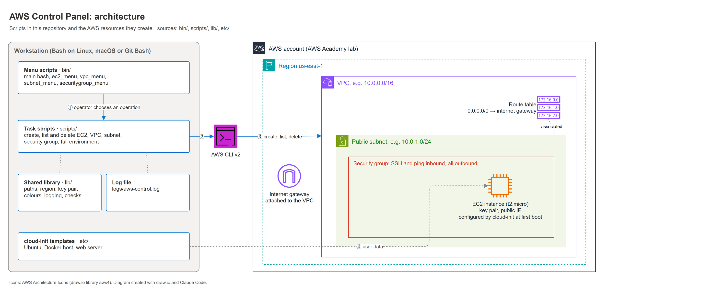
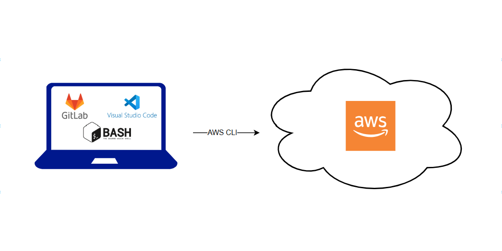
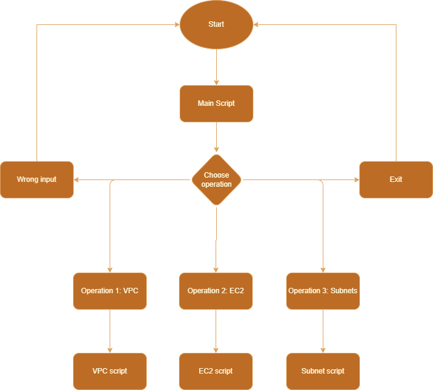
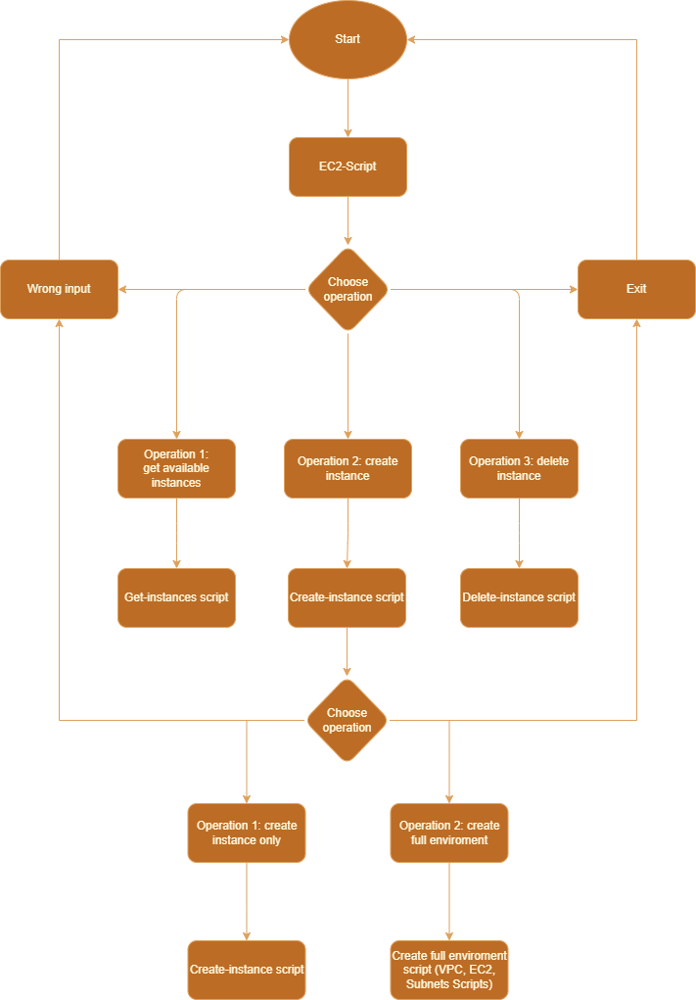
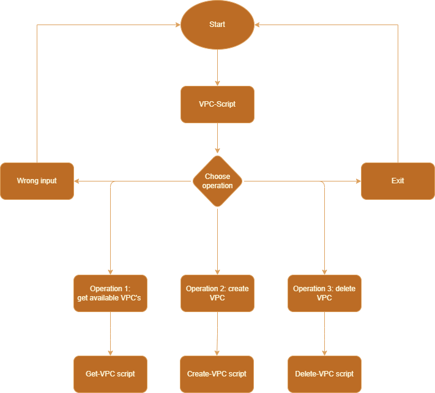
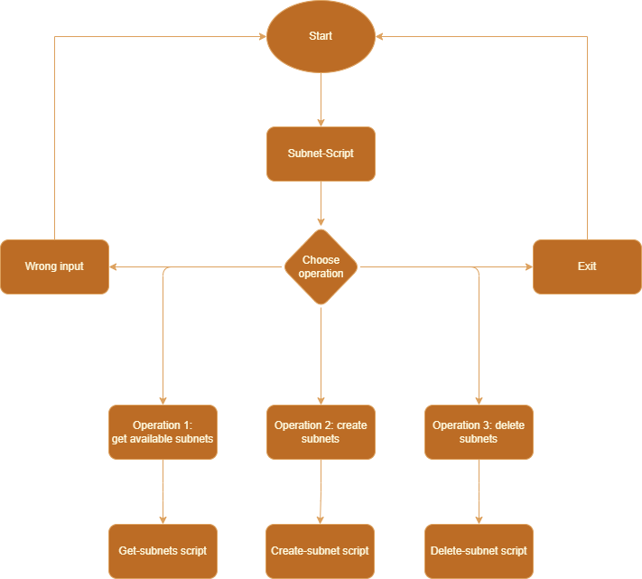
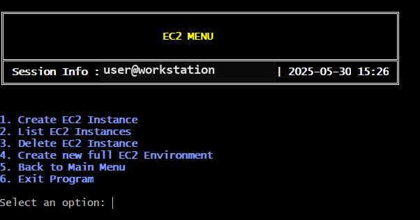

# Architecture

## Overview

The control panel is a set of Bash scripts on top of the AWS CLI. It separates the interactive front end from the operations that change AWS:

| Layer | Location | Responsibility |
|---|---|---|
| Menu scripts | `bin/` | Draw the menus, read the user's choice and start the matching task script |
| Task scripts | `scripts/` | Perform one operation each (create, list or delete a resource) via the AWS CLI |
| Shared library | `lib/` | Paths, AWS defaults, colours, header, logging, prerequisite checks |
| Server configuration | `etc/` | cloud-init templates passed to new EC2 instances as user data |



*Created with draw.io; icons: AWS Architecture Icons.*



*Development setup: scripts are written in VS Code, versioned in Git and talk to AWS through the AWS CLI.*

## Control flow

The flowcharts below were drawn before implementation to plan the menu logic. Every menu follows the same pattern: show the options, dispatch to a task script, handle wrong input, and return to the menu or exit. The draw.io sources are in [`diagrams/`](diagrams/).

| Main menu | EC2 menu |
|---|---|
|  |  |

| VPC menu | Subnet menu |
|---|---|
|  |  |

## Menu scripts

[`bin/main.bash`](../bin/main.bash) is the entry point. It prints an ASCII-art banner and a session box (user, host, timestamp) and offers the EC2, VPC, subnet and security group menus.

Each sub-menu ([`ec2_menu.bash`](../bin/ec2_menu.bash), [`vpc_menu.bash`](../bin/vpc_menu.bash), [`subnet_menu.bash`](../bin/subnet_menu.bash), [`securitygroup_menu.bash`](../bin/securitygroup_menu.bash)) is built the same way. A main loop repeatedly calls four functions:

| Function | Purpose |
|---|---|
| `print_header` | Shows the menu title and session information |
| `show_menu` | Lists the available operations |
| `handle_input` | Starts the selected task script in its own Bash process |
| `pause` | Waits for the user before the menu is redrawn |

The loop only starts when the script is executed directly (`if [[ "${BASH_SOURCE[0]}" == "${0}" ]]`), so a menu can also be sourced by another script without side effects.



## Task scripts

Every task script follows the same structure, which keeps them small and predictable:

1. Load the shared environment: `source "$(dirname "${BASH_SOURCE[0]}")/../lib/init_env.bash"`.
2. Write a start entry to the log.
3. Implement the operation in a single function, including input validation and clear error messages.
4. Run `check_aws_requirements` first, which verifies that the AWS CLI is installed and the credentials are valid.
5. Return a non-zero exit code on failure.

Because of this structure, a task script can be started from a menu, called directly from the shell or used in another automation. Parameters that are not set as environment variables are requested interactively.

| Resource | Create | List | Delete |
|---|---|---|---|
| EC2 instance | `ec2_create.bash` | `ec2_list.bash` | `ec2_delete.bash` |
| VPC | `vpc_create.bash` | `vpc_list.bash` | `vpc_delete.bash` |
| Subnet | `subnet_create.bash`, `subnet_createVPC.bash` | `subnet_list.bash` | `subnet_delete.bash` |
| Security group | `securitygroup_create.bash` | `securitygroup_list.bash` | `securitygroup_delete.bash` |
| Full environment | `ec2_fullenviroment.bash`: VPC, subnet, internet gateway, route table, security group and instance in one run | | |

[`securitygroup_delete.bash`](../scripts/securitygroup_delete.bash) is a compact example of the pattern.

## Shared library

[`lib/init_env.bash`](../lib/init_env.bash) resolves all directories relative to the repository root (`bin`, `etc`, `lib`, `logs`, `scripts`) and loads:

- [`aws_config.bash`](../lib/aws_config.bash): default region, instance type, key pair name and user-data path.
- [`variables.bash`](../lib/variables.bash): header rendering, logging and the AWS prerequisite check.
- [`colors.bash`](../lib/colors.bash): ANSI colour definitions for consistent output.

### Logging

`log <LEVEL> <message>` writes a timestamped entry to `logs/aws-control.log` and to the console. `LOGLEVEL` controls the verbosity: errors are always logged, `INFO` adds normal progress messages and `DEBUG` logs everything. The log makes automated runs traceable and simplifies troubleshooting.

```bash
log() {
    local level="$1" message="$2" timestamp
    timestamp=$(date +"%Y-%m-%d %H:%M:%S")
    if [[ "$level" == "ERROR" || "$level" == "$LOGLEVEL" || "$LOGLEVEL" == "DEBUG" ]]; then
        echo "[$timestamp] [$level] $message" >> "$LOGFILE"
        echo -e "[$timestamp] [$level] $message"
    fi
}
```

## Server configuration with cloud-init

When an instance is created, the operator can choose one of the cloud-init templates in [`etc/`](../etc/). The configuration runs at first boot:

| Template | Result |
|---|---|
| `Template_Ubuntu.yaml` | Personal sudo user with SSH key, team keys for the default user, base packages (curl, wget, vim, nano, htop, net-tools) |
| `Template_Ubuntu_Docker.yaml` | Ubuntu container host with Docker CE and Podman, default user in the `docker` group |
| `Template_Linux_Webserver.yaml` | Shell user-data script for Amazon Linux that installs Apache `httpd` and serves a test page |

As a safeguard, `Template_Ubuntu.yaml` disables cloud-init after the first run (`/etc/cloud/cloud-init.disabled`), so later reboots cannot re-apply the configuration unintentionally. The password hash and SSH keys in the published templates are placeholders.

## Design decisions

| Decision | Reason |
|---|---|
| Bash and AWS CLI instead of an SDK or Terraform | Focus of the semester: shell automation and the AWS CLI; no extra runtime needed |
| Separate menu and task scripts | Tasks stay testable and reusable outside the menu |
| Each task in its own process | A failing task cannot break the menu loop |
| Relocatable paths | Scripts work regardless of the current working directory |
| Defaults for region and key pair | Fewer prompts; the trade-off is less flexibility (see [retrospective](retrospective.md)) |
