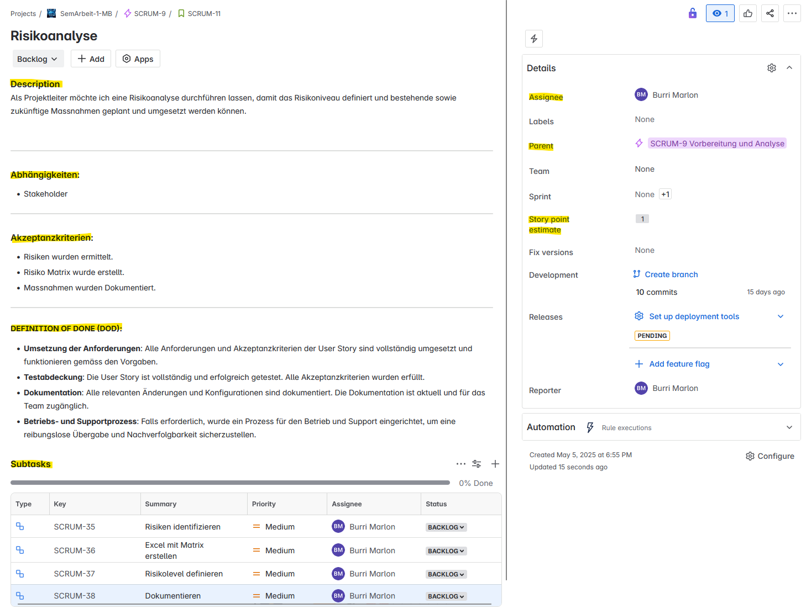
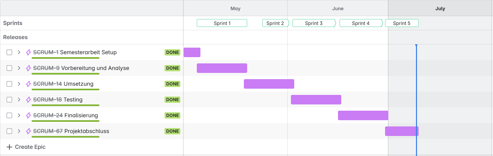
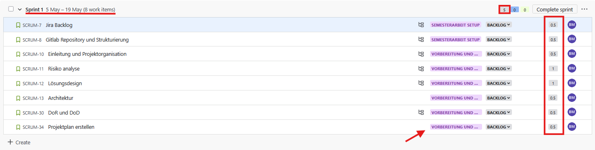
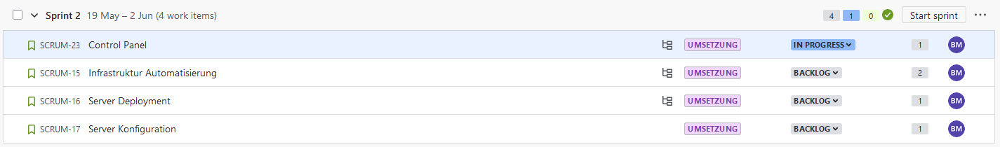
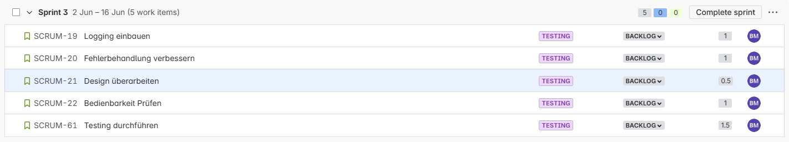
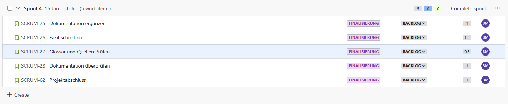
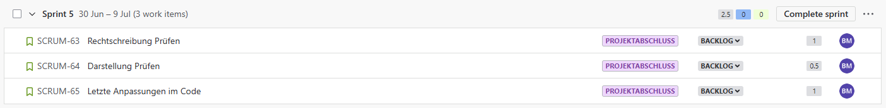
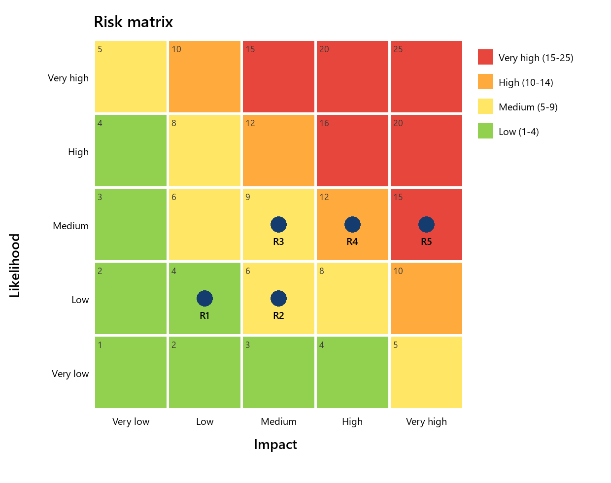

# Project management

## Problem

In the AWS module of the course, EC2 instances and the VPCs and subnets around them had to be created by hand again and again. The repetition was slow and error-prone, which led to the question of how this could be automated sensibly. The control panel removes the need for the web console: every step runs on the command line, and combined with cloud-init, servers come up ready to use.

## Goals

| Goal | Description |
|---|---|
| Efficiency through automation | Create, configure and delete EC2 instances, VPCs, subnets and security groups by script instead of by hand |
| Independence from the web console | Full control over the supported resources from the shell via Bash and the AWS CLI |
| Standardisation and reuse | Structured scripts with reusable templates and parameters, versioned in Git |

## Scope

**In scope:** creating, listing and deleting EC2 instances, VPCs, subnets and security groups; cloud-init based server configuration; logging and error handling.

**Out of scope:** other AWS services, renaming, duplicating or extending existing resources, and multi-user or team operation.

## Method and tools

The project was run with **Scrum** as a one-person team: five two-week sprints with planning, review and a defined capacity of five story points per sprint (one story point = one working day). Because the team consisted of a single person, backlog refinement was merged into sprint planning.

| Area | Tools |
|---|---|
| Development | Bash, AWS CLI, cloud-init, VS Code, Git |
| Planning | Jira (backlog, sprints, timeline) |
| Documentation | Markdown, Mermaid, draw.io |
| Environment | AWS Academy account |

### Backlog structure

```text
Project
└── Epic
    └── User story   "As a <role> I want <goal> so that <benefit>."
        └── Subtask
```

Every user story has a description, acceptance criteria and dependencies. A Jira automation rule inserted the Definition of Done into every new backlog item.



### Definition of Ready

- **Content:** complete description, clear goal, all acceptance criteria defined and reviewed.
- **Technical:** dependencies identified and documented, required resources known.
- **Plannable:** fits into one sprint (split into subtasks if needed), no open blockers.

### Definition of Done

- **Implemented:** all requirements and acceptance criteria are met.
- **Tested:** the story has been tested successfully against its acceptance criteria.
- **Documented:** all relevant changes and configuration are documented.
- **Operable:** where needed, a process for operation and support is in place.

## Timeline

| Sprint | Period | Goal |
|---|---|---|
| 1 | 05.05.–19.05.2025 | Project setup, planning, risk analysis, solution design |
| 2 | 19.05.–02.06.2025 | Control panel, network automation, server deployment and configuration |
| 3 | 02.06.–16.06.2025 | Refactoring, logging, error handling, usability, testing |
| 4 | 16.06.–30.06.2025 | Final testing, conclusions, documentation |
| 5 | 30.06.–09.07.2025 | Review and final polish (half-length sprint) |



## Sprints

### Sprint 1: foundation

Goal: everything prepared so that implementation can start. Delivered the introduction and project organisation, risk analysis, solution design, architecture, Definition of Ready and Done, and the project plan. Feedback from the review: content created with AI support has to be marked and the prompts listed in the references; the Jira timeline is sufficient as a project plan.



### Sprint 2: implementation

Goal: a first working control panel. Delivered the main menu and sub-menus, EC2 handling, network automation and cloud-init based server configuration. The review included a short live demo. Sprint goal fully reached.



### Sprint 3: quality and usability

Feedback from the subject matter expert was turned into stories: organise the scripts in a clear directory structure (`bin`, `lib`, `etc`, `logs`), use relocatable paths, and make every script runnable on its own. Delivered logging, improved error handling, a design overhaul, a usability check and the test run. The review pointed out that the reflection should address objections to the chosen solution and alternative approaches more critically (see [retrospective](retrospective.md)).



### Sprint 4: conclusions and documentation

Delivered the technical and personal conclusions, the glossary and a review of all references. The project was ready for submission at the end of the sprint.



### Sprint 5: final polish

Half-length sprint for proofreading, presentation checks and last code adjustments. All stories completed.



## Risk analysis

Each risk was rated for likelihood and impact on a scale from 1 to 5; the product gives the risk level: low (1–4), medium (5–9), high (10–14), very high (15–25).



| ID | Risk | Likelihood | Impact | Level | Mitigation |
|---|---|---|---|---|---|
| R1 | A script deletes resources without confirmation | 2 | 2 | 4 low | Confirmation prompt, dry-run, logging |
| R2 | IAM roles are configured insufficiently | 2 | 3 | 6 medium | Review roles, apply least privilege |
| R3 | Script errors due to missing validation or error handling | 3 | 3 | 9 medium | `set -e`, `trap`, regular validation |
| R4 | Uncontrolled creation of resources | 3 | 4 | 12 high | Tag resources, clean up regularly |
| R5 | Misconfigured code exposes secrets or grants wrong permissions | 3 | 5 | 15 very high | No plain-text credentials, SSH keys for EC2 |
