# Testing

## Approach

The scripts were validated continuously during development. At the end of the project, ten test cases were defined that together cover all project goals: navigation, creating and deleting resources, error handling, logging and running tasks without the menu. A passing run of all cases confirms that the control panel works as specified.

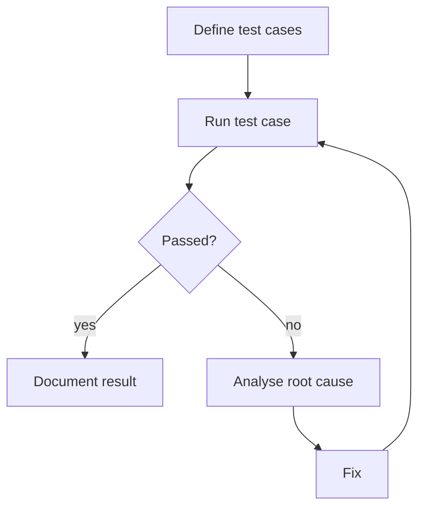

All tests ran in the project environment described in the [architecture](architecture.md): a local workstation with Bash and the AWS CLI against an AWS Academy account (region `us-east-1`). Host names in the recordings are masked.

## Results

| # | Test case | Expected result | Result |
|---|---|---|---|
| 1 | Start the main menu with `./bin/main.bash` | Main menu with EC2, VPC, subnet and security group options | Passed |
| 2 | Open the EC2 menu from the main menu | EC2 menu with EC2-specific operations | Passed |
| 3 | Delete a security group | Selected security group is deleted, success message shown | Passed |
| 4 | Enter an invalid security group ID | Script stops with a clear error message | Passed |
| 5 | Create an EC2 instance | New instance is created and shown with its public IP | Passed |
| 6 | Delete an EC2 instance | Instance is terminated and no longer listed | Passed |
| 7 | Create a subnet in an existing VPC | Subnet is created with the given CIDR and availability zone | Passed |
| 8 | List all security groups | Table of all security groups in the terminal | Passed |
| 9 | Log script output | Every step is written to the log file with a timestamp | Passed |
| 10 | Run a task script without the menu | Task runs independently and returns its result | Passed |

**10 of 10 test cases passed.**

## Test cases in detail

### 1. Start the main menu

| | |
|---|---|
| Preconditions | Bash installed, AWS CLI configured, repository cloned |
| Steps | 1. Open a terminal 2. Run `./bin/main.bash` in the project directory |
| Expected | The main menu is shown and offers EC2, VPC, subnet and security group |
| Actual | The menu appears and reacts to input |

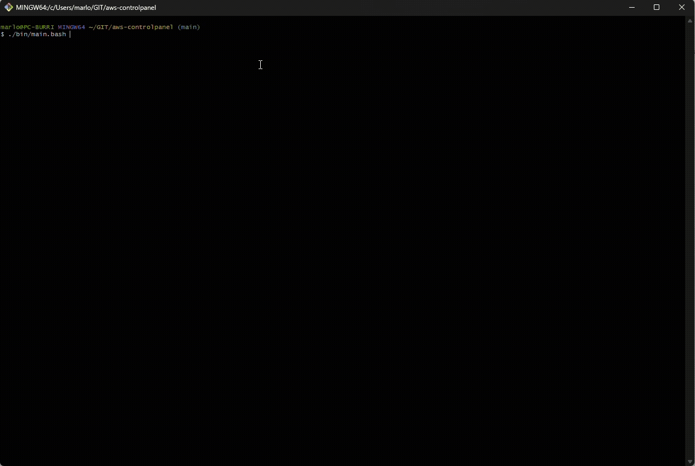

### 2. Navigate to the EC2 menu

| | |
|---|---|
| Preconditions | Main menu is open |
| Steps | 1. Start the main menu 2. Select "EC2" |
| Expected | The EC2 menu loads with EC2-specific operations |
| Actual | The EC2 menu appears |

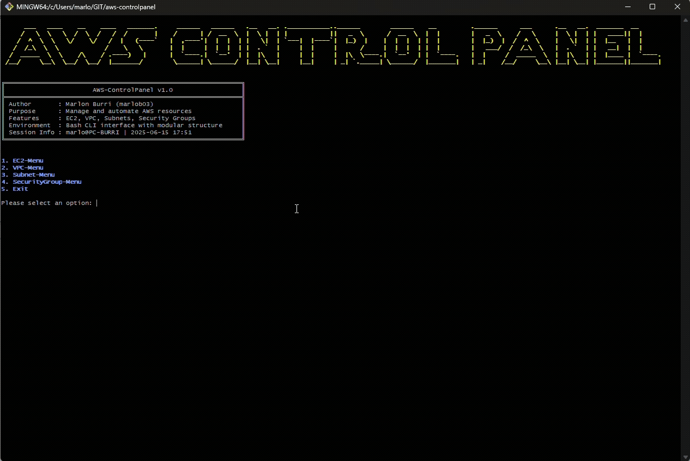

### 3. Delete a security group

| | |
|---|---|
| Preconditions | AWS CLI configured, permission to delete security groups, a security group exists |
| Steps | 1. Run `./scripts/securitygroup_delete.bash` 2. Review the listed groups 3. Enter an ID and confirm |
| Expected | The selected security group is deleted |
| Actual | The group is deleted and a success message is shown. A group that is still in use is rejected by AWS with a clear error |

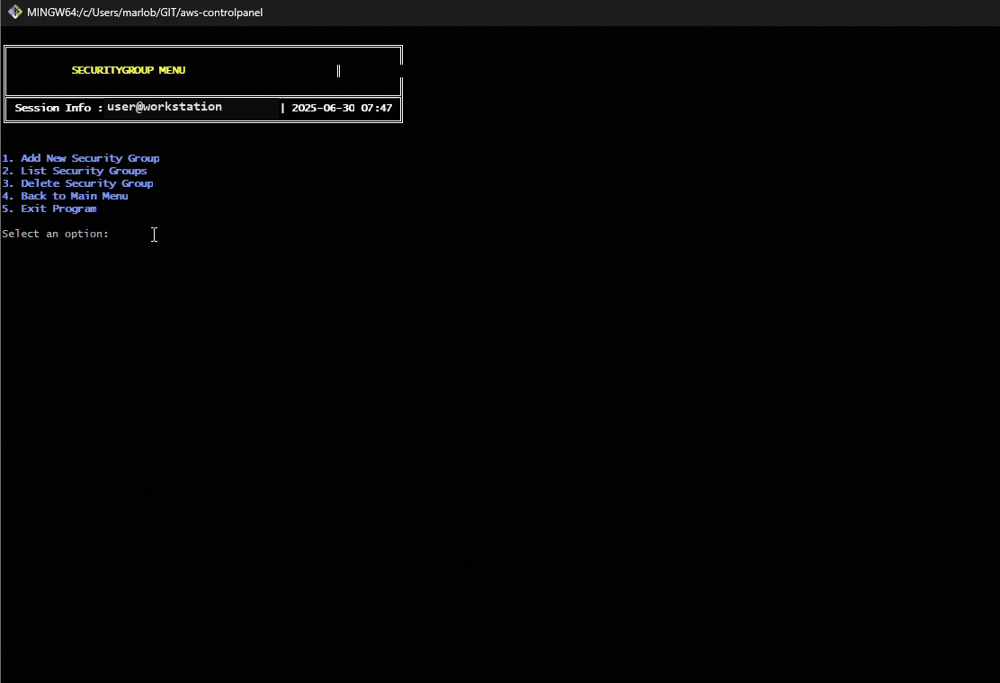

### 4. Invalid security group ID

| | |
|---|---|
| Preconditions | AWS CLI configured |
| Steps | 1. Start the script 2. Enter a non-existent or empty ID 3. Confirm |
| Expected | The script aborts and reports the invalid ID |
| Actual | An error message is printed and logged, the script exits |

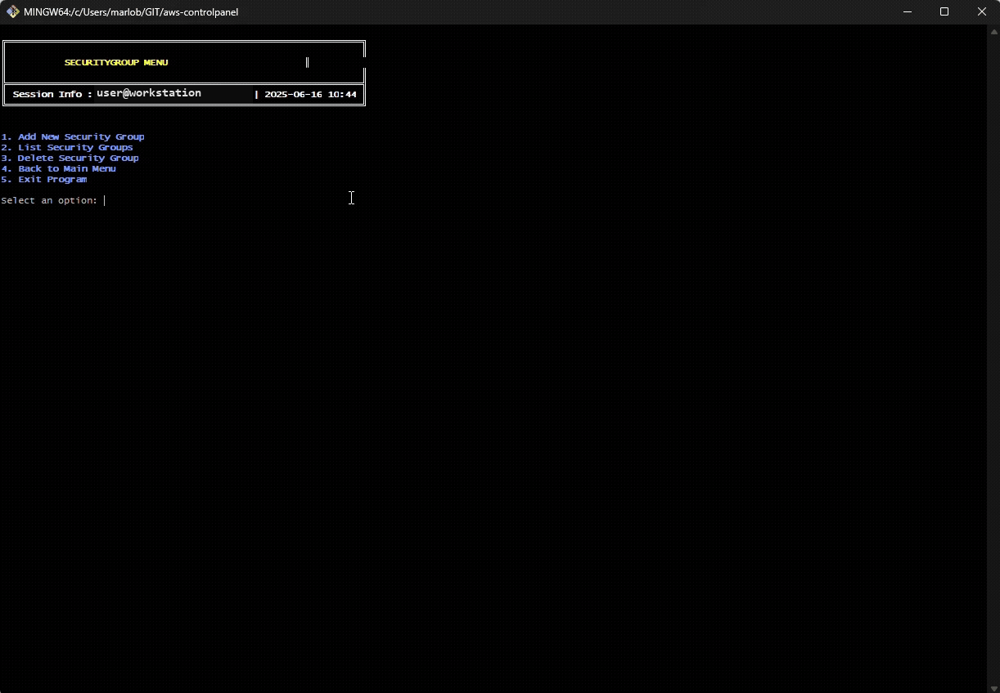

### 5. Create an EC2 instance

| | |
|---|---|
| Preconditions | AWS CLI configured, a subnet and security group are available |
| Steps | 1. Open the EC2 menu 2. Choose AMI, cloud-init template, security group and subnet 3. Start the creation |
| Expected | A new instance is created and reported |
| Actual | The instance starts and its public IP is shown |
| Notes | A wrong AMI ID or missing permissions are detected and reported |

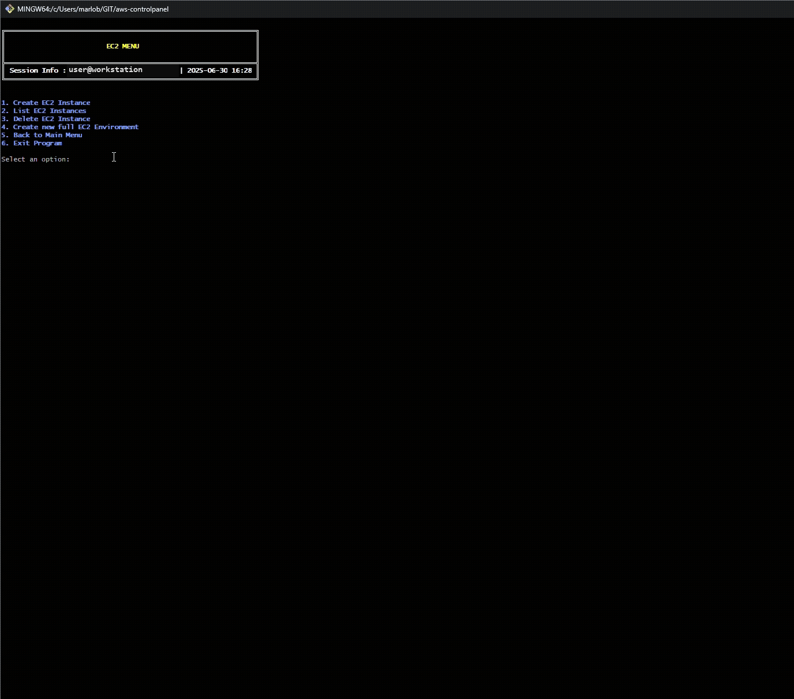

### 6. Delete an EC2 instance

| | |
|---|---|
| Preconditions | An instance exists |
| Steps | 1. Open the EC2 menu 2. Select the instance 3. Confirm deletion |
| Expected | The instance is terminated |
| Actual | The instance is no longer listed as running |

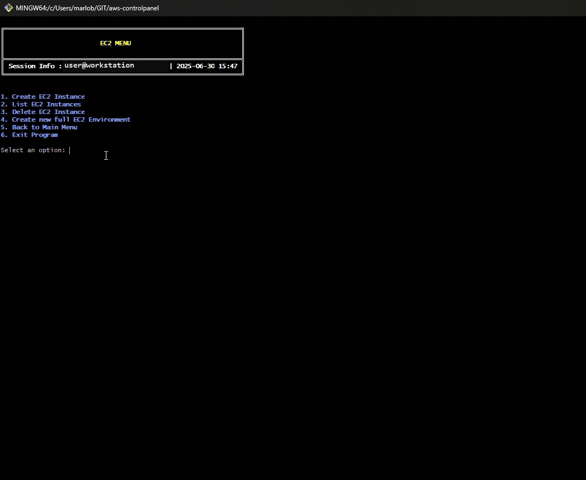

### 7. Create a subnet

| | |
|---|---|
| Preconditions | A VPC exists |
| Steps | 1. Start the subnet task 2. Enter VPC, CIDR, name and availability zone |
| Expected | A new subnet is created |
| Actual | The subnet is created and its ID is shown. Overlapping CIDR ranges are rejected |

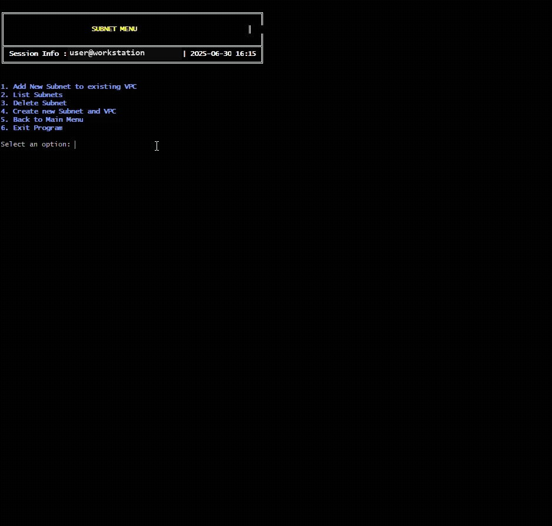

### 8. List security groups

| | |
|---|---|
| Preconditions | AWS CLI configured |
| Steps | 1. Open the security group menu 2. Choose "List" |
| Expected | All security groups are listed |
| Actual | A table with ID, name, description and VPC is shown |

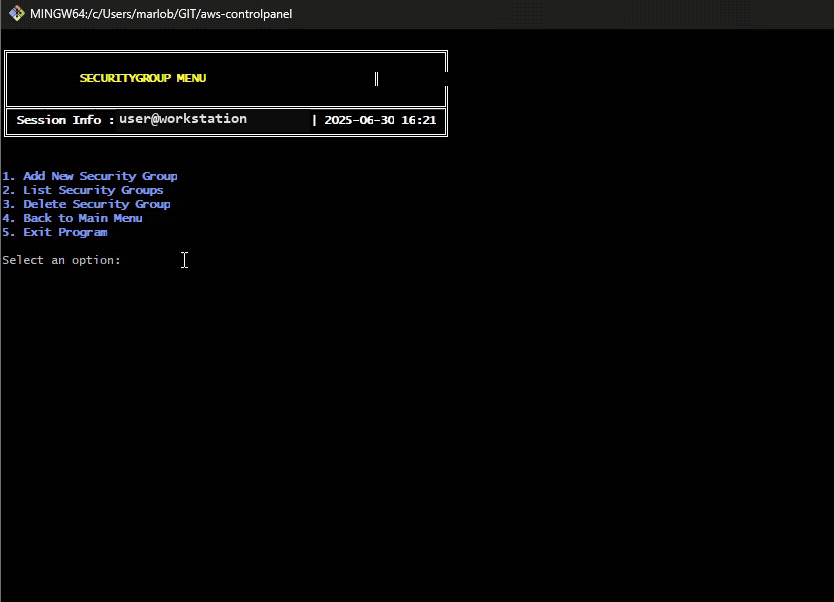

### 9. Logging

| | |
|---|---|
| Preconditions | `log()` implemented, `LOGLEVEL` set |
| Steps | 1. Run several tasks 2. Check the terminal output 3. Check `logs/aws-control.log` |
| Expected | Every step is logged with a timestamp and severity |
| Actual | Log entries are present for all steps |

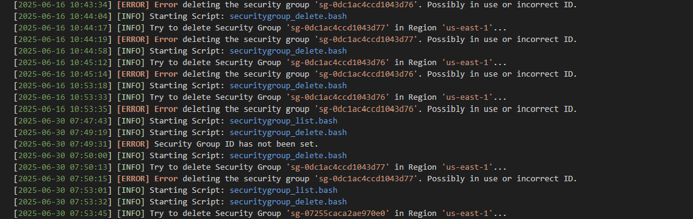

### 10. Run a task script directly

| | |
|---|---|
| Preconditions | AWS CLI configured |
| Steps | 1. Open a terminal 2. Run `./scripts/ec2_list.bash` |
| Expected | The task runs without the menu |
| Actual | The instances are listed correctly |

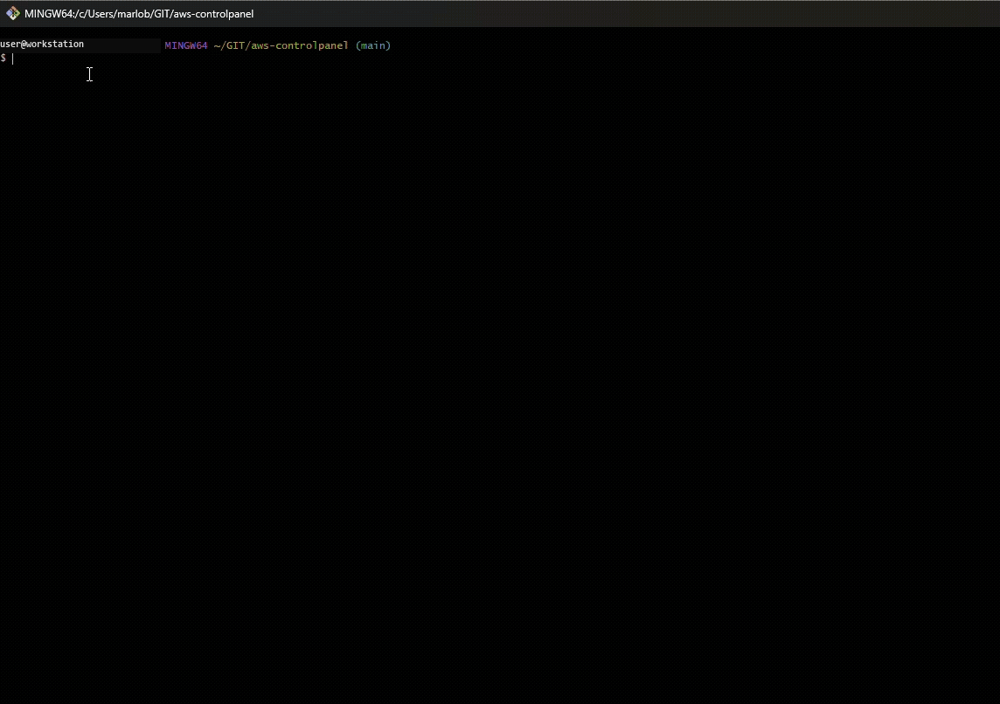
